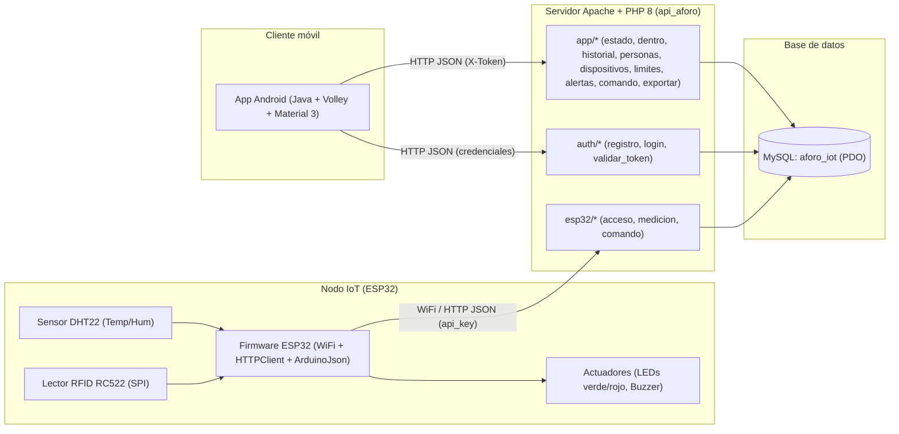
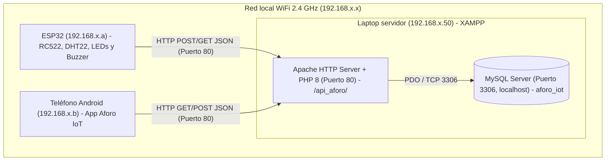

# 2. Arquitectura del sistema y diagrama de despliegue

**Proyecto:** Aforo IoT — Sistema de control de acceso con RFID y monitoreo ambiental  
**Fecha:** Noviembre de 2026  
**Responsable:** OsvaldoVar

---

## 2.1 Descripción por capas

El sistema **Aforo IoT** adopta una arquitectura cliente–servidor en cuatro capas desacopladas. El nodo IoT y la aplicación móvil no se comunican directamente entre sí; ambos interactúan exclusivamente con una API REST centralizada que encapsula la lógica de negocio y el acceso a los datos.

1. **Capa de dispositivo (Hardware y firmware ESP32):**  
   Encargada de la captura física de eventos y la respuesta local. El microcontrolador ESP32 integra un lector RFID RC522 (interfaz SPI) para leer el UID de las tarjetas, un sensor DHT22 para medir temperatura y humedad relativa, y actuadores locales (LED verde, LED rojo y buzzer). El firmware gestiona la conexión WiFi, el antirrebote de tarjetas (3 s), el envío periódico de mediciones (15 s) y la consulta de comandos remotos (3 s) utilizando programación no bloqueante con `millis()`.

2. **Capa de servicios (API REST PHP 8):**  
   Alojada en el servidor Apache de XAMPP bajo la ruta `/api_aforo/`. Expone tres grupos de endpoints que intercambian mensajes JSON con estructura uniforme (`success`, `mensaje` y datos específicos):
   - `auth/`: registro de usuarios (`registro.php`), inicio de sesión con generación de token (`login.php`) y validación de sesión (`validar_token.php`).
   - `esp32/`: recepción de lecturas RFID con regla de alternancia entrada/salida y validación de `aforo_max` (`acceso.php`), registro de mediciones ambientales y evaluación de umbrales (`medicion.php`), y entrega de comandos pendientes (`comando.php`).
   - `app/`: consulta del estado actual (`estado.php`, `dentro.php`), historiales filtrados (`historial_accesos.php`, `historial_mediciones.php`), administración de `dispositivos.php`, `personas.php`, `limites.php` y `alertas.php`, encolado de acciones (`comando.php`) y exportación (`exportar.php`).

3. **Capa de datos (MySQL `aforo_iot`):**  
   Base de datos relacional accedida desde PHP mediante PDO con sentencias preparadas para prevenir inyección SQL. Almacena las tablas `usuarios`, `personas`, `tarjetas_pendientes`, `dispositivos`, `registros_acceso`, `mediciones`, `limites`, `alertas` y `comandos`, además de la vista `personas_dentro`, que calcula en tiempo real qué personas tienen como último movimiento una `entrada` por dispositivo.

4. **Capa de presentación (Aplicación Android):**  
   Aplicación nativa desarrollada en Java con Volley para peticiones HTTP/JSON y componentes de Material Design 3 (`Theme.Material3.DayNight.NoActionBar`). Persiste el token de sesión en `SharedPreferences` y ofrece pantallas de inicio de sesión, tablero en vivo con refresco automático cada 5 s, lista de ocupantes, historial con selector de fechas, gestión de personas y dispositivos, configuración de límites, alertas con notificaciones locales, gráficas de 24 h (MPAndroidChart), botones de control remoto y exportación a CSV.

---

## 2.2 Diagrama de componentes

---

## 2.3 Diagrama de despliegue

Los tres nodos del sistema operan dentro de la misma red local WiFi (2.4 GHz, subred `192.168.x.x`). El servidor XAMPP ejecuta Apache en el puerto TCP `80` (expuesto a la LAN) y MySQL en el puerto TCP `3306` (acceso local desde PHP en `localhost`). Para pruebas en emulador Android Studio en el mismo equipo, la app utiliza el alias `10.0.2.2:80`.

---

## 2.4 Flujo de un dato

El recorrido completo desde la lectura de una tarjeta RFID hasta su visualización en la aplicación móvil ocurre en los siguientes pasos:

1. **Captura en el ESP32:** el usuario acerca una tarjeta al lector RC522. El firmware obtiene el UID en hexadecimal mayúsculas y verifica la ventana de antirrebote de 3 s para evitar duplicados si la tarjeta permanece pegada.
2. **Envío HTTP al backend:** el ESP32 construye un cuerpo JSON con `api_key` y `uid`, y envía una petición `POST` a `esp32/acceso.php`.
3. **Autenticación y registro de actividad:** PHP valida que `api_key` corresponda a un dispositivo activo en `dispositivos` y actualiza `ultima_conexion = NOW()`.
4. **Identificación y regla de acceso:** PHP busca el UID en `personas`.
   - Si la tarjeta no existe, la registra en `tarjetas_pendientes` y responde `success: false`.
   - Si existe, consulta el último registro de esa persona en `registros_acceso`: si fue `entrada`, el nuevo evento es `salida`; en caso contrario, es `entrada`.
   - Si el evento es `entrada`, compara el conteo actual de la vista `personas_dentro` contra `limites.aforo_max`. Si el recinto está lleno, rechaza la entrada (`error: "aforo_lleno"`), inserta una alerta tipo `aforo` en `alertas` y no registra el acceso. Las salidas siempre se permiten.
   - Si la operación es válida, inserta el registro en `registros_acceso` y devuelve `success: true`, `tipo`, `nombre` y el nuevo conteo `dentro`.
5. **Respuesta local en el nodo:** al recibir la respuesta JSON, el ESP32 enciende el LED verde durante 1.5 s si el acceso fue permitido, o el LED rojo con tres pitidos del buzzer si fue denegado o la tarjeta no está registrada.
6. **Visualización en la app Android (polling de 5 s):** `DashboardActivity` ejecuta un `Handler` cada 5 s que envía `GET app/estado.php?dispositivo_id=N` (y `app/dentro.php`) con el encabezado `X-Token`. PHP valida el token, consulta la vista `personas_dentro`, `limites`, la última fila de `mediciones` y calcula `en_linea` (`ultima_conexion` menor a 30 s). La app actualiza el contador, la barra de progreso de aforo, la lista de personas presentes y los valores de temperatura y humedad sin recarga manual.

De forma paralela, el ESP32 envía lecturas del DHT22 cada 15 s a `esp32/medicion.php` (generando alertas si superan `temp_max` o `hum_max`) y consulta `GET esp32/comando.php` cada 3 s para ejecutar acciones remotas encoladas desde la app.

---

## 2.5 Tecnologías y versiones

| Capa | Tecnología / Herramienta | Versión / Detalle | Función en el sistema |
| --- | --- | --- | --- |
| Hardware | ESP32 (WiFi 2.4 GHz), RC522, DHT22, LEDs, buzzer | RC522 a 3.3 V; LEDs con resistencia de 220 Ω | Lectura RFID, sensado ambiental y señalización local |
| Firmware | Arduino IDE (C++ para ESP32) | Core ESP32 | Compilación y carga del firmware `esp32_aforo` |
| Firmware | `ArduinoJson` | 7.x | Serialización y deserialización JSON en el ESP32 |
| Firmware | `MFRC522` y `DHT sensor library` | Estables (Arduino Library Manager) | Controladores para lector RFID y sensor DHT22 |
| Servidor web | XAMPP (Apache HTTP Server) | Puerto TCP 80 | Ejecución de la API REST en red local |
| Backend | PHP | 8.x (PDO, `password_hash`, `password_verify`) | Lógica de negocio, autenticación y endpoints JSON |
| Base de datos | MySQL (XAMPP / phpMyAdmin) | Puerto TCP 3306 (`aforo_iot`) | Persistencia relacional y vista `personas_dentro` |
| App móvil | Android Studio / Java | Android 9+ (`network_security_config`) | Cliente móvil nativo (`com.example.aforoiot`) |
| App móvil | Material Components for Android | `1.12.0` (`Theme.Material3.DayNight.NoActionBar`) | Interfaz Material Design 3 con modo claro y oscuro |
| App móvil | Volley | Estándar Android | Cola de peticiones HTTP/JSON asíncronas |
| App móvil | MPAndroidChart (vía JitPack) | Última estable en JitPack | Gráficas de temperatura, humedad y entradas por hora |
| Gestión y pruebas | Git, GitHub, Postman, Figma, Wokwi / Fritzing | Flujo `main` / `develop` / `feature/*` | Control de versiones, pruebas de API, mockups y diagramas |

---

## 2.6 Decisiones de diseño

### Polling HTTP frente a comunicación Push (WebSockets / MQTT / FCM)

Se eligió **polling HTTP periódico** (cada 5 s en el tablero de la app, cada 3 s para comandos y cada 15 s para mediciones en el ESP32) en lugar de WebSockets, MQTT o Firebase Cloud Messaging. Esta decisión simplifica el despliegue sobre un servidor XAMPP estándar (Apache + PHP sin demonios persistentes ni brokers externos), reduce la superficie de fallos en una red local sin acceso obligatorio a servicios en la nube y ofrece una latencia máxima de 4–5 segundos, adecuada para el control de aforo y monitoreo ambiental del proyecto.

### Autenticación con `api_key` frente a encabezado `X-Token`

Se separaron los mecanismos de autenticación según el tipo de cliente:
- El ESP32 envía una **`api_key` única por dispositivo** dentro del cuerpo JSON. Esto permite revocar o desactivar un nodo individual desde la app sin afectar a los usuarios humanos ni requerir flujos de login en el microcontrolador.
- La aplicación Android utiliza un **token de sesión por usuario** enviado en el encabezado HTTP **`X-Token`**. Se eligió `X-Token` en lugar del encabezado estándar `Authorization` porque la configuración predeterminada de Apache en XAMPP suele filtrar o eliminar `Authorization` antes de llegar a PHP, evitando fallos de compatibilidad en distintos equipos del equipo de desarrollo.

### Alternancia entrada/salida controlada en el servidor

La determinación de si una lectura RFID corresponde a una `entrada` o a una `salida` se realiza en el servidor PHP consultando el último registro de la persona en MySQL, y no en la memoria RAM del ESP32. De este modo, el estado de ocupación sobrevive a reinicios o cortes eléctricos del microcontrolador, se centraliza la verificación estricta de `aforo_max` antes de confirmar una entrada y se garantiza que las salidas nunca sean bloqueadas.

### Desacoplamiento ESP32–App mediante API REST

El microcontrolador nunca se comunica directamente con el teléfono móvil. Centralizar todo el tráfico en la API REST asegura persistencia histórica inmediata en MySQL, permite que múltiples dispositivos consulten el mismo estado sin saturar al ESP32 y cumple con la arquitectura de tres niveles requerida para el proyecto.
