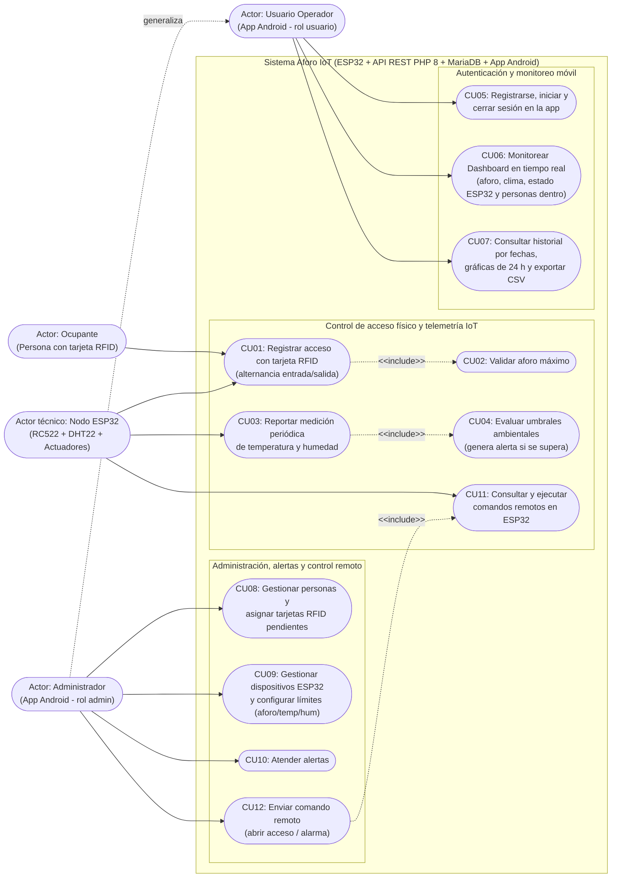

# 2. Usuarios, requerimientos y casos de uso

**Proyecto:** Aforo IoT — Sistema de control de acceso con RFID y monitoreo ambiental
**Fecha:** Noviembre de 2026
**Responsable:** OscarJDA

---

## 2.1 Perfiles de usuario y actores del sistema

El sistema **Aforo IoT** involucra cuatro actores diferenciados por su rol operativo, nivel de privilegios y canal de interacción (aplicación móvil Android, interacción física con el nodo IoT o comunicación máquina a máquina con la API REST):

| Actor / Rol | Representación en el sistema | Canal de interacción | Responsabilidades y alcance operativo |
| --- | --- | --- | --- |
| **Administrador** | Tabla `usuarios` (`rol = 'admin'`) | Aplicación móvil Android (`X-Token`) | Responsable del recinto (laboratorio, aula o local). Supervisa en tiempo real el aforo y el clima, administra el catálogo de personas y asigna tarjetas RFID pendientes, registra y gestiona dispositivos ESP32 (`api_key`), configura umbrales (`aforo_max`, `temp_max`, `hum_max`), atiende alertas, ejecuta comandos remotos (`abrir_acceso`, `alarma`), consulta historiales y gráficas de 24 h y exporta reportes en CSV. |
| **Usuario operador / supervisor** | Tabla `usuarios` (`rol = 'usuario'`) | Aplicación móvil Android (`X-Token`) | Personal autorizado con cuenta en la aplicación móvil. Consulta el tablero en vivo (ocupación actual, personas dentro, estado en línea del ESP32, temperatura y humedad), revisa el historial de accesos y mediciones por rango de fechas, visualiza gráficas de tendencias y monitorea las alertas del espacio. |
| **Ocupante (Persona con tarjeta RFID)** | Tabla `personas` (`uid_rfid`, `activo = 1`) y `tarjetas_pendientes` | Físico (lector RFID RC522, LEDs verde/rojo y buzzer en el ESP32) | Estudiante, docente, colaborador o visitante que ingresa y sale del recinto presentando su tarjeta RFID ISO/IEC 14443A. No utiliza la aplicación móvil; recibe retroalimentación local inmediata en el punto de acceso (LED verde al autorizar entrada o salida; LED rojo y pitidos del buzzer si el aforo está lleno o la tarjeta no está asignada). |
| **Nodo IoT ESP32** *(actor técnico autónomo)* | Tabla `dispositivos` (`api_key`, `activo = 1`) | API REST HTTP/JSON (`esp32/acceso.php`, `esp32/medicion.php`, `esp32/comando.php`) | Microcontrolador en red local WiFi 2.4 GHz que captura lecturas del módulo RC522 (con antirrebote de 3 s), mide temperatura y humedad con el sensor DHT22 cada 15 s, consulta comandos remotos pendientes cada 3 s y acciona los indicadores luminosos y sonoros sin bloquear su bucle principal (`millis()`). |

---

## 2.2 Requerimientos funcionales (RF)

Los requerimientos funcionales definen el comportamiento esperado en las cuatro capas del sistema (nodo ESP32, API REST en PHP 8, base de datos MariaDB/MySQL y aplicación Android):

### Resumen general de requerimientos funcionales

| Código | Nombre del requerimiento | Capa(s) involucrada(s) | Prioridad | Sprint |
| --- | --- | --- | --- | --- |
| **RF01** | Registro, autenticación y gestión de sesión de usuarios | App Android, API (`auth/*`), BD (`usuarios`) | Alta | Sprint 1 |
| **RF02** | Administración de dispositivos ESP32, personas y tarjetas pendientes | App Android, API (`app/dispositivos.php`, `app/personas.php`), BD (`dispositivos`, `personas`, `tarjetas_pendientes`) | Alta | Sprint 2 |
| **RF03** | Adquisición de lecturas RFID y mediciones ambientales en el nodo IoT | Firmware ESP32, API (`esp32/acceso.php`, `esp32/medicion.php`), BD (`mediciones`) | Alta | Sprint 1–2 |
| **RF04** | Control de acceso con alternancia entrada/salida y validación de aforo máximo | API (`esp32/acceso.php`), BD (`registros_acceso`, `limites`, `personas_dentro`, `alertas`), Firmware ESP32 | Alta | Sprint 1–2 |
| **RF05** | Monitoreo en tiempo real en el Dashboard móvil | App Android (`DashboardActivity`), API (`app/estado.php`, `app/dentro.php`), BD (`personas_dentro`, `mediciones`, `dispositivos`) | Alta | Sprint 2 |
| **RF06** | Configuración de límites y gestión de alertas con notificaciones | App Android (`LimitesActivity`, `AlertasActivity`), API (`app/limites.php`, `app/alertas.php`), BD (`limites`, `alertas`) | Alta | Sprint 2–3 |
| **RF07** | Control remoto bidireccional hacia el ESP32 (`abrir_acceso` y `alarma`) | App Android (`DashboardActivity`), API (`app/comando.php`, `esp32/comando.php`), BD (`comandos`), Firmware ESP32 | Alta | Sprint 3 |
| **RF08** | Consulta de historial por fechas, gráficas de 24 h y exportación a CSV | App Android (`HistorialActivity`, `GraficasActivity`), API (`app/historial_accesos.php`, `app/historial_mediciones.php`, `app/exportar.php`), BD | Media | Sprint 2–3 |

### Especificación detallada por requerimiento funcional

#### RF01 — Registro, autenticación y gestión de sesión de usuarios
- **RF01.1 (Registro de cuenta):** El sistema debe permitir el registro de nuevos usuarios desde `RegistroActivity` enviando `nombre`, `correo` y `password` a `POST auth/registro.php`, validando formato de correo, longitud mínima de contraseña (6 caracteres), unicidad de `correo` en la tabla `usuarios` y almacenando el hash generado con `password_hash()`.
- **RF01.2 (Inicio de sesión):** El sistema debe autenticar al usuario desde `LoginActivity` mediante `POST auth/login.php` verificando la contraseña con `password_verify()`, generando un token aleatorio seguro de 64 caracteres hexadecimales (`random_bytes(32)`) almacenado en `usuarios.token` y devolviendo los datos del usuario junto con el token.
- **RF01.3 (Persistencia y cierre de sesión):** La aplicación Android debe persistir el token y el nombre del usuario en `SharedPreferences` a través de `SessionManager`, redirigir automáticamente a la pantalla principal al reabrir la app si existe sesión activa, enviar el encabezado `X-Token` en toda petición a `app/*` y permitir cerrar sesión limpiando `SharedPreferences` y regresando a `LoginActivity`.

#### RF02 — Administración de dispositivos ESP32, personas y tarjetas pendientes
- **RF02.1 (Gestión de dispositivos):** El sistema debe permitir listar los nodos ESP32 registrados indicando su nombre, ubicación, `api_key`, fecha de `ultima_conexion`, indicador `en_linea` y `aforo_max`, así como dar de alta nuevos dispositivos (creando automáticamente sus límites iniciales en `limites`), copiar su `api_key` al portapapeles y activar o desactivar nodos desde `DispositivosActivity` (`app/dispositivos.php`).
- **RF02.2 (Catálogo de personas):** El sistema debe permitir listar, registrar, editar y dar de baja lógica (`activo = 0`) a las personas autorizadas vinculadas a un `uid_rfid` único en hexadecimal mayúsculas desde `PersonasActivity` (`app/personas.php`).
- **RF02.3 (Asignación de tarjetas pendientes):** Cuando un ESP32 lea una tarjeta cuyo UID no exista en `personas`, el backend debe registrarla o actualizar su marca temporal en `tarjetas_pendientes`. `PersonasActivity` debe mostrar las tarjetas pendientes detectadas para asignarlas directamente al formulario de alta de una persona y eliminarlas de `tarjetas_pendientes` una vez vinculadas.

#### RF03 — Adquisición de lecturas RFID y mediciones ambientales en el nodo IoT
- **RF03.1 (Lectura RFID con antirrebote):** El firmware del ESP32 debe leer tarjetas compatibles con el módulo RC522 por bus SPI, formatear el UID en hexadecimal mayúsculas sin separadores (ej. `A1B2C3D4`) y aplicar una ventana de antirrebote de `3000 ms` (`millis()`) para evitar lecturas duplicadas continuas de la misma tarjeta.
- **RF03.2 (Medición periódica DHT22):** El ESP32 debe leer temperatura (°C) y humedad relativa (%) del sensor DHT22 cada `15000 ms`, descartar lecturas inválidas (`isnan()`) sin bloquear ni reiniciar el microcontrolador, y enviar los valores válidos mediante `POST esp32/medicion.php` autenticado con `api_key`.
- **RF03.3 (Señalización física local):** El ESP32 debe indicar el resultado de cada operación mediante `LED_VERDE` (GPIO 25), `LED_ROJO` (GPIO 26) y `BUZZER` (GPIO 27) con temporizadores no bloqueantes: LED verde durante `1500 ms` en acceso permitido; LED rojo `1500 ms` y 3 pitidos cortos en tarjeta desconocida o error HTTP; LED rojo `1500 ms` y 2 pitidos largos cuando el acceso se rechaza por `aforo_lleno`.

#### RF04 — Control de acceso con alternancia entrada/salida y validación de aforo máximo
- **RF04.1 (Alternancia en el servidor):** Al recibir `POST esp32/acceso.php` con `api_key` y `uid`, el backend debe validar que el dispositivo esté activo, actualizar `dispositivos.ultima_conexion = NOW()`, localizar a la persona activa por `uid_rfid` y consultar su último movimiento en `registros_acceso` para ese dispositivo: si el último registro fue `entrada`, el nuevo movimiento se clasifica como `salida`; en caso contrario (sin registros previos o último registro `salida`), se clasifica como `entrada`.
- **RF04.2 (Verificación de aforo máximo):** Antes de registrar una `entrada`, el servidor debe comparar el total actual de ocupantes en la vista `personas_dentro` para ese dispositivo contra `limites.aforo_max`. Si `dentro >= aforo_max`, debe denegar la entrada devolviendo `success: false` y `error: "aforo_lleno"`, sin insertar fila en `registros_acceso`, y registrar una alerta tipo `aforo`.
- **RF04.3 (Garantía de salida libre):** Si el movimiento calculado para una persona es `salida`, el sistema debe permitirlo y registrarlo siempre en `registros_acceso`, independientemente de si el aforo actual iguala o supera `aforo_max`.

#### RF05 — Monitoreo en tiempo real en el Dashboard móvil
- **RF05.1 (Refresco automático del estado):** `DashboardActivity` debe consultar cada `5000 ms` (`Handler` / `Runnable` activo en el ciclo de vida visible de la pantalla) el endpoint `GET app/estado.php?dispositivo_id=N` para mostrar: chip de estado del nodo (`ESP32 en línea` si `ultima_conexion < 30 s`, o `ESP32 sin conexión`), conteo `dentro / aforo_max`, barra `LinearProgressIndicator` con color semántico (`primary` < 80 %, `statusWarning` 80–99 %, `error` 100 %) y última lectura de temperatura y humedad.
- **RF05.2 (Lista de personas dentro):** El Dashboard (y la vista de Personas) debe consultar `GET app/dentro.php?dispositivo_id=N` (respaldado por la vista SQL `personas_dentro`) y mostrar en un `RecyclerView` el nombre y la `hora_entrada` de cada ocupante que permanece actualmente en el recinto, o un estado vacío explícito cuando no haya ocupantes.

#### RF06 — Configuración de límites y gestión de alertas con notificaciones
- **RF06.1 (Configuración de umbrales):** El administrador debe poder consultar y modificar desde `LimitesActivity` (`GET` y `POST/PUT app/limites.php`) los valores de `aforo_max` (entero > 0), `temp_max` (0–60 °C) y `hum_max` (0–100 %) asociados a un dispositivo.
- **RF06.2 (Generación automática de alertas):** El backend debe insertar automáticamente un registro en la tabla `alertas` (`atendida = 0`) cuando `esp32/acceso.php` rechace una entrada por alcanzar `aforo_max` (tipo `aforo`) o cuando `esp32/medicion.php` reciba una lectura que supere `temp_max` (tipo `temperatura`) o `hum_max` (tipo `humedad`).
- **RF06.3 (Consulta, notificación local y atención de alertas):** La app Android debe listar en `AlertasActivity` (`GET app/alertas.php`) las alertas filtradas por estado (pendientes o atendidas) y tipo, disparar una notificación local de Android al detectar nuevas alertas sin atender durante el monitoreo y permitir marcarlas como atendidas (`atendida = 1`).

#### RF07 — Control remoto bidireccional hacia el ESP32
- **RF07.1 (Encolado de comandos desde la app):** El administrador debe poder solicitar desde `DashboardActivity` las acciones remotas **Abrir acceso** (`accion = 'abrir_acceso'`) y **Activar alarma** (`accion = 'alarma'`), mostrando un diálogo de confirmación (`MaterialAlertDialog`) antes de enviar `POST app/comando.php`, el cual inserta el comando con `estado = 'pendiente'`.
- **RF07.2 (Consulta y ejecución en el ESP32):** El ESP32 debe consultar cada `3000 ms` el endpoint `GET esp32/comando.php?api_key=...`. Si existe un comando `pendiente`, el servidor lo devuelve y actualiza su estado a `ejecutado` (`fecha_ejecucion = NOW()`); el ESP32 ejecuta de inmediato la acción física (`LED_VERDE` por `3000 ms` + 1 pitido corto para `abrir_acceso`, o parpadeo de `LED_ROJO` + 5 pitidos durante `2000 ms` para `alarma`).

#### RF08 — Consulta de historial por fechas, gráficas de 24 h y exportación a CSV
- **RF08.1 (Historial con filtro de fechas):** `HistorialActivity` debe presentar dos pestañas (`TabLayout`: **Accesos** y **Mediciones**) y un selector de rango de fechas (`MaterialDatePicker`) que consulten `GET app/historial_accesos.php` y `GET app/historial_mediciones.php` filtrados por `dispositivo_id`, fecha de inicio y fecha de fin.
- **RF08.2 (Gráficas de tendencias de 24 horas):** `GraficasActivity` debe graficar mediante `MPAndroidChart` la evolución de temperatura y humedad de las últimas 24 horas (gráfica de líneas) y la distribución de entradas por hora (gráfica de barras).
- **RF08.3 (Exportación a CSV):** Desde `HistorialActivity`, el usuario debe poder descargar o compartir un archivo CSV generado por `GET app/exportar.php` (`Content-Type: text/csv; charset=utf-8`) con los registros de accesos o mediciones correspondientes al rango consultado.

---

## 2.3 Requerimientos no funcionales (RNF)

| Código | Categoría | Especificación y criterio de verificación |
| --- | --- | --- |
| **RNF01** | **Rendimiento y latencia** | • Los endpoints de la API REST deben responder en **menos de 1 segundo** en red local para tablas con al menos **1 000 registros**, utilizando los índices definidos en `database/schema.sql`. • El tablero de `DashboardActivity` debe refrescarse cada **5 s** sin congelar el hilo principal de interfaz (peticiones asíncronas con Volley). • Los comandos remotos (`abrir_acceso`, `alarma`) deben ejecutarse en el ESP32 con una latencia máxima inferior a **4 s** desde su confirmación en la app (polling del ESP32 cada **3 s**). |
| **RNF02** | **Seguridad** | • Las contraseñas de usuarios nunca se almacenan ni registran en texto plano; se procesan con `password_hash()` y `password_verify()`. • Todas las consultas SQL en PHP utilizan **PDO con sentencias preparadas** (`prepare` + `execute`) y un usuario de base de datos dedicado (`aforo`), prohibiendo la concatenación de entradas y el uso de `root`. • Autenticación segregada: encabezado HTTP `X-Token` para endpoints `app/*` y clave `api_key` por dispositivo para endpoints `esp32/*`. • Ningún archivo de credenciales (`config.php`, `config.h`, `.env`) se versiona en Git (excluidos en `.gitignore`). Los errores internos (`PDOException`) se registran con `error_log()` sin exponer trazas ni SQL al cliente. |
| **RNF03** | **Usabilidad y diseño Material 3** | • Aplicación Android construida con **Material Components `1.12.0`** y tema `Theme.Material3.DayNight.NoActionBar` (soporte completo para modo claro y oscuro con color semilla `#00639B`). • Contraste visual mínimo de **4.5:1** en texto normal y **3:1** en texto grande e íconos (los pares definidos en `docs/ESTETICA.md` superan **6.4:1**). • Áreas táctiles mínimas de **`48dp × 48dp`**, navegación inferior de 4 destinos (`BottomNavigationView`), barra superior `MaterialToolbar`, mensajes mediante `Snackbar` (sin `Toast`), confirmaciones con `MaterialAlertDialog` y estados explícitos de carga, vacío y error con opción de reintento. |
| **RNF04** | **Confiabilidad y tolerancia a fallos** | • El firmware del ESP32 opera sin `delay()` bloqueantes en `loop()`, empleando `millis()` para que la señalización LED/buzzer y las peticiones HTTP no interrumpan la lectura de tarjetas RC522. • El nodo IoT descarta lecturas `NaN` del sensor DHT22 sin colgarse y reintenta automáticamente la conexión WiFi ante desconexiones. • El estado de quién se encuentra dentro reside en la base de datos del servidor (vista `personas_dentro`), por lo que un corte eléctrico o reinicio del ESP32 no provoca pérdida ni desincronización del aforo. • La app Android captura fallos de red o JSON malformado sin cerrarse inesperadamente y redirige a `LoginActivity` si recibe HTTP `401`. |
| **RNF05** | **Compatibilidad y entorno** | • **App móvil:** Android 7.0 (API 24) o superior en Java, con `network_security_config.xml` que permite tráfico HTTP en claro hacia la red local (IP variable por DHCP y `10.0.2.2` en el emulador). • **Servidor:** PHP 8.x (`pdo_mysql`) sobre servidor integrado (`php -S 0.0.0.0:8080 -t backend`) o Apache/XAMPP, y MariaDB 10.4+ / MySQL 8.0+. • **Hardware:** ESP32 en red WiFi de 2.4 GHz; lector RC522 alimentado estrictamente a **3.3 V**; LEDs con resistencias limitadoras de **220 Ω**. |
| **RNF06** | **Mantenibilidad y estándares** | • Cumplimiento de `docs/ESTANDARES.md` y `.editorconfig` (codificación UTF-8, saltos de línea `LF`, identificadores en español sin acentos, textos de UI en `res/values/strings.xml` y colores por atributos `?attr/...`). • Desarrollo bajo flujo Git Flow ligero (`main`, `develop`, ramas `feature/<ID>-<tema>`) con revisión por Pull Request antes de integrar. |

---

## 2.4 Diagrama de casos de uso UML

El siguiente diagrama representa los actores del sistema, el límite de **Aforo IoT** y las relaciones entre los casos de uso (`CU01`–`CU12`), incluyendo dependencias `<<include>>` entre casos de uso:

---

## 2.5 Especificación de casos de uso

A continuación se documentan las fichas técnicas de los casos de uso del sistema:

### CU01 — Registrar acceso con tarjeta RFID (alternancia entrada/salida) y CU02 — Validar aforo máximo

| Campo | Descripción |
| --- | --- |
| **ID y nombre** | **CU01 / CU02** — Registrar acceso con tarjeta RFID y validar aforo máximo |
| **Actores** | Primario: **Ocupante (Persona con tarjeta RFID)** / Secundario técnico: **Nodo IoT ESP32** |
| **Requerimientos** | `RF03`, `RF04`, `RNF01`, `RNF02`, `RNF04` |
| **Precondiciones** | 1. El nodo ESP32 está encendido, conectado a la red WiFi local y posee una `api_key` activa en la tabla `dispositivos`. 2. Han transcurrido al menos 3 segundos desde la última lectura de la misma tarjeta en el lector RC522. |
| **Flujo principal (Exitoso)** | 1. El ocupante acerca su tarjeta RFID al lector RC522 del ESP32. 2. El ESP32 obtiene el UID en hexadecimal mayúsculas, verifica el antirrebote de 3 s y envía `POST esp32/acceso.php` con `{"api_key": "...", "uid": "..."}`. 3. La API valida la `api_key`, actualiza `dispositivos.ultima_conexion = NOW()` y busca el UID en `personas` (`activo = 1`). 4. La API consulta el último registro de esa persona en `registros_acceso` para el dispositivo: si fue `entrada`, determina `tipo = 'salida'`; en caso contrario, determina `tipo = 'entrada'`. 5. Si es `entrada`, la API verifica en la vista `personas_dentro` que `dentro < limites.aforo_max`. 6. La API inserta el movimiento en `registros_acceso` y responde HTTP `200` con `{"success": true, "tipo": "entrada|salida", "nombre": "...", "dentro": N}`. 7. El ESP32 enciende el `LED_VERDE` durante `1500 ms` indicando acceso autorizado. |
| **Flujos alternativos** | **FA1 — Tarjeta no registrada (`uid` no existe en `personas`):** En el paso 3, la API inserta o actualiza el UID en `tarjetas_pendientes` para ese `dispositivo_id` y responde `{"success": false, "error": "tarjeta_no_registrada"}`. El ESP32 enciende el `LED_ROJO` por `1500 ms` y emite 3 pitidos cortos (`100 ms`) en el buzzer. **FA2 — Aforo máximo alcanzado (`dentro >= aforo_max` en una entrada):** En el paso 5, la API rechaza la entrada sin insertar en `registros_acceso`, registra una alerta de tipo `aforo` en `alertas` y responde `{"success": false, "error": "aforo_lleno", "dentro": N}`. El ESP32 enciende el `LED_ROJO` por `1500 ms` y emite 2 pitidos largos (`300 ms`). **FA3 — Salida con aforo al límite:** Si el cálculo del paso 4 determina `salida`, el paso 5 se omite y la salida se registra siempre con éxito (`LED_VERDE`). |
| **Postcondiciones** | Se registra el movimiento en `registros_acceso` (actualizando la vista `personas_dentro`), o bien se registra la tarjeta en `tarjetas_pendientes` / la alerta de aforo en `alertas`, y se actualiza `ultima_conexion` del dispositivo. |

---

### CU03 — Reportar medición periódica de temperatura y humedad y CU04 — Evaluar umbrales ambientales

| Campo | Descripción |
| --- | --- |
| **ID y nombre** | **CU03 / CU04** — Reportar medición ambiental y evaluar umbrales ambientales |
| **Actor** | **Nodo IoT ESP32** (disparo automático por temporizador cada 15 s) |
| **Requerimientos** | `RF03`, `RF06`, `RNF01`, `RNF04` |
| **Precondiciones** | El ESP32 está conectado a la red WiFi y el temporizador no bloqueante (`millis()`) alcanza `INTERVALO_MEDICION` (`15000 ms`). |
| **Flujo principal** | 1. El ESP32 solicita temperatura (°C) y humedad relativa (%) al sensor DHT22. 2. El firmware comprueba que ambos valores sean numéricos válidos (`!isnan(t) && !isnan(h)`) y envía `POST esp32/medicion.php` con `{"api_key": "...", "temperatura": t, "humedad": h}`. 3. La API valida `api_key`, verifica que los valores estén dentro del rango físico válido (`0–60 °C` y `0–100 %`), actualiza `ultima_conexion = NOW()` e inserta la fila en `mediciones`. 4. La API consulta `limites` del dispositivo (`temp_max`, `hum_max`). Si algún valor supera su límite, inserta la alerta correspondiente (`tipo = 'temperatura'` o `tipo = 'humedad'`, `atendida = 0`) en la tabla `alertas` (RF06). 5. La API responde HTTP `200` con `{"success": true, "medicion_id": N, "dispositivo_id": N, "temperatura": t, "humedad": h}`. |
| **Flujos alternativos** | **FA1 — Lectura `NaN` del sensor DHT22:** En el paso 2, el firmware descarta la lectura, registra el aviso en el monitor serie (`115200` baudios), no envía petición HTTP y continúa ejecutando `loop()` sin bloquear el lector RC522. **FA2 — Valores fuera de rango físico:** En el paso 3, la API responde HTTP `400 Bad Request` y no contamina la tabla `mediciones`. |
| **Postcondiciones** | Nueva medición almacenada en `mediciones`, `ultima_conexion` actualizada y, en caso de exceso de umbral, alerta activa creada en `alertas`. |

---

### CU05 — Registrarse, iniciar y cerrar sesión en la aplicación móvil

| Campo | Descripción |
| --- | --- |
| **ID y nombre** | **CU05** — Registrarse, iniciar y cerrar sesión en la aplicación Android |
| **Actores** | **Usuario Operador** y **Administrador** |
| **Requerimientos** | `RF01`, `RNF02`, `RNF03` |
| **Precondiciones** | La aplicación Android tiene conectividad HTTP con el servidor PHP en la red local (`Config.BASE_URL`). |
| **Flujo principal** | 1. Al abrir la app, `LoginActivity` verifica `SessionManager.estaLogueado()`. Si no hay token guardado, presenta el formulario Material 3 (`tilCorreo`, `tilContrasena`, `btnLogin`). 2. El usuario ingresa su correo y contraseña (o accede a `RegistroActivity` para crear una cuenta nueva mediante `POST auth/registro.php`). 3. La app valida que los campos no estén vacíos y envía `POST auth/login.php` con Volley. 4. La API verifica las credenciales con `password_verify()`, genera y guarda `usuarios.token` y devuelve `{"success": true, "token": "...", "nombre": "...", "rol": "...", "usuario_id": N}`. 5. La app guarda la sesión en `SharedPreferences` mediante `SessionManager.guardarSesion(...)` y navega a la pantalla principal. 6. Cuando el usuario selecciona **Cerrar sesión** en la `MaterialToolbar` y confirma el `MaterialAlertDialog`, la app invoca `SessionManager.cerrarSesion()` y vuelve a `LoginActivity` limpiando la pila de actividades. |
| **Flujos alternativos** | **FA1 — Campos vacíos o inválidos:** La app muestra el mensaje de validación directamente en `TextInputLayout.setError(...)` sin enviar petición de red. **FA2 — Credenciales incorrectas (login) o correo duplicado (registro):** La API responde con `success: false` y mensaje descriptivo; la app lo presenta en un `Snackbar`. |
| **Postcondiciones** | Sesión autenticada con `X-Token` persistido en `SharedPreferences`, o sesión eliminada de forma segura al cerrar sesión. |

---

### CU06 — Monitorear Dashboard en tiempo real

| Campo | Descripción |
| --- | --- |
| **ID y nombre** | **CU06** — Monitorear Dashboard en tiempo real (aforo, clima, estado del ESP32 y personas dentro) |
| **Actores** | **Usuario Operador** y **Administrador** |
| **Requerimientos** | `RF05`, `RNF01`, `RNF03`, `RNF04` |
| **Precondiciones** | Usuario con sesión activa (`X-Token` válido en `SessionManager`). |
| **Flujo principal** | 1. El usuario accede a la pestaña **Dashboard** en `BottomNavigationView`. 2. La app solicita cada 5 s `GET app/estado.php?dispositivo_id=N` y `GET app/dentro.php?dispositivo_id=N` enviando el encabezado `X-Token`. 3. La API valida el token, calcula `dentro` desde la vista `personas_dentro`, obtiene `aforo_max`, `temp_max`, `hum_max`, la última fila de `mediciones` y evalúa `en_linea` (`TIMESTAMPDIFF(SECOND, ultima_conexion, NOW()) < 30`). 4. La app actualiza `chipEstado` (`ESP32 en línea` o `ESP32 sin conexión`), la cifra `txtDentro`, el indicador `progresoAforo` (cambiando su color según el porcentaje de ocupación), `txtTemperatura`, `txtHumedad` y el `RecyclerView` (`rvDentro`) con las personas actualmente dentro. |
| **Flujos alternativos** | **FA1 — Recinto vacío (`dentro == 0`):** El listado muestra el estado vacío Material 3 (*"No hay personas dentro"*). **FA2 — Error de red o token expirado (HTTP 401):** Si falla la red, se muestra un `Snackbar` con acción **Reintentar** sin cerrar la app; si recibe HTTP `401`, `SessionManager` limpia la sesión y redirige a `LoginActivity`. |
| **Postcondiciones** | El usuario visualiza el estado actualizado del recinto con un desfase máximo de 5 segundos. |

---

### CU07 — Consultar historial por fechas, gráficas de 24 h y exportar CSV

| Campo | Descripción |
| --- | --- |
| **ID y nombre** | **CU07** — Consultar historial filtrado, visualizar gráficas de 24 h y exportar reportes CSV |
| **Actores** | **Usuario Operador** y **Administrador** |
| **Requerimientos** | `RF08`, `RNF01`, `RNF03` |
| **Precondiciones** | Usuario autenticado con `X-Token` válido. |
| **Flujo principal** | 1. El usuario abre la sección **Historial** y alterna en el `TabLayout` entre **Accesos** y **Mediciones**. 2. El usuario selecciona un rango de fechas con `MaterialDatePicker`; la app consulta `GET app/historial_accesos.php` o `GET app/historial_mediciones.php` y renderiza los registros en el `RecyclerView`. 3. Si el usuario accede a **Gráficas**, la app consulta las últimas 24 horas y dibuja con `MPAndroidChart` las curvas de temperatura/humedad y las barras de entradas por hora. 4. Si el usuario pulsa **Exportar CSV** en la `MaterialToolbar`, la app consume `GET app/exportar.php` con el filtro activo y guarda o comparte el archivo `.csv`. |
| **Flujos alternativos** | **FA1 — Sin registros en el rango:** Se presenta la vista de estado vacío (*"Sin registros en este rango de fechas"*). |
| **Postcondiciones** | Historial y gráficas desplegados en pantalla o archivo CSV exportado en el dispositivo móvil. |

---

### CU08 — Gestionar personas y asignar tarjetas RFID pendientes

| Campo | Descripción |
| --- | --- |
| **ID y nombre** | **CU08** — Administrar catálogo de personas y asignar tarjetas RFID pendientes |
| **Actor** | **Administrador** |
| **Requerimientos** | `RF02`, `RNF02`, `RNF03` |
| **Precondiciones** | Usuario autenticado; para asignación rápida, una tarjeta no registrada fue leída previamente por el ESP32 (**CU01-FA1**). |
| **Flujo principal** | 1. El administrador abre la pestaña **Personas**; la app consulta `GET app/personas.php` y muestra las tarjetas detectadas en `tarjetas_pendientes` junto con el padrón de personas registradas. 2. El administrador pulsa **Asignar** sobre una tarjeta pendiente (precargando su `uid_rfid`) o pulsa el `FloatingActionButton` para registrar manualmente nombre y UID. 3. La app envía `POST app/personas.php` con `nombre` y `uid_rfid` en hexadecimal mayúsculas. 4. La API inserta la persona en `personas`, elimina el UID de `tarjetas_pendientes` dentro de la misma operación y devuelve HTTP `201 Created`. 5. El administrador también puede editar el nombre o desactivar (`activo = 0`) una persona existente. |
| **Flujos alternativos** | **FA1 — UID duplicado:** Si el `uid_rfid` ya pertenece a otra persona, la API devuelve error `400`/`409` y la app lo informa mediante `Snackbar`. |
| **Postcondiciones** | La tarjeta RFID queda vinculada a una persona activa en `personas` y habilitada para registrar entradas y salidas en el ESP32. |

---

### CU09 — Gestionar dispositivos ESP32 y configurar límites

| Campo | Descripción |
| --- | --- |
| **ID y nombre** | **CU09** — Administrar dispositivos ESP32 y configurar límites de aforo, temperatura y humedad |
| **Actor** | **Administrador** |
| **Requerimientos** | `RF02`, `RF06`, `RNF02`, `RNF03` |
| **Precondiciones** | Usuario autenticado en la aplicación Android. |
| **Flujo principal** | 1. El administrador entra a **Dispositivos** (`DispositivosActivity`), donde visualiza cada nodo ESP32, su estado en línea, ubicación y `api_key` (con botón para copiarla al portapapeles). 2. Mediante el `FloatingActionButton`, registra un nuevo dispositivo indicando `nombre` y `ubicacion` (`POST app/dispositivos.php`), lo que genera su `api_key` y su fila inicial en `limites`. 3. Desde **Límites** (`LimitesActivity`), el administrador ajusta `aforo_max`, `temp_max` y `hum_max` del dispositivo y envía `POST/PUT app/limites.php`. 4. La API valida que `aforo_max > 0`, `0 < temp_max <= 60` y `0 < hum_max <= 100`, actualiza la tabla `limites` y confirma el guardado. |
| **Flujos alternativos** | **FA1 — Umbrales fuera de rango:** La app o la API rechazan los valores inválidos y muestran el error en `TextInputLayout` / `Snackbar`. |
| **Postcondiciones** | Nuevos umbrales persistidos en `limites` y aplicados de inmediato a las siguientes peticiones de `esp32/acceso.php` y `esp32/medicion.php`. |

---

### CU10 — Atender alertas

| Campo | Descripción |
| --- | --- |
| **ID y nombre** | **CU10** — Consultar y marcar alertas como atendidas |
| **Actor** | **Administrador** |
| **Requerimientos** | `RF06`, `RNF02`, `RNF03` |
| **Precondiciones** | Usuario autenticado y alertas registradas en la tabla `alertas`. |
| **Flujo principal** | 1. En **Alertas** (`AlertasActivity`), el administrador revisa las alertas pendientes (`atendida = 0`) por exceso de temperatura, humedad o intento de ingreso con aforo lleno. 2. Pulsa **Atender** (`POST/PUT app/alertas.php`); la API marca la alerta con `atendida = 1`. |
| **Flujos alternativos** | **FA1 — Sin alertas pendientes:** La lista muestra el estado vacío correspondiente. |
| **Postcondiciones** | Alerta marcada como atendida en `alertas`. |

---

### CU12 — Enviar comando remoto y CU11 — Ejecutar comando en el ESP32

| Campo | Descripción |
| --- | --- |
| **ID y nombre** | **CU12 / CU11** — Enviar y ejecutar comandos remotos (`abrir_acceso`, `alarma`) en el ESP32 |
| **Actores** | Primario: **Administrador** / Secundario técnico: **Nodo IoT ESP32** |
| **Requerimientos** | `RF07`, `RNF01`, `RNF03` |
| **Precondiciones** | Usuario autenticado y nodo ESP32 activo en la red local. |
| **Flujo principal** | 1. En **Dashboard**, el administrador pulsa **Abrir acceso** o **Activar alarma** y confirma la operación en el `MaterialAlertDialog`. 2. La app envía `POST app/comando.php` con `dispositivo_id` y `accion` (`abrir_acceso` o `alarma`); la API inserta la fila en `comandos` con `estado = 'pendiente'`. 3. En su siguiente ciclo de polling (máximo 3 s), el ESP32 ejecuta **CU11** invocando `GET esp32/comando.php?api_key=...`. 4. La API entrega el comando pendiente más antiguo y lo marca como `estado = 'ejecutado'` y `fecha_ejecucion = NOW()`. 5. El ESP32 acciona los indicadores físicos sin bloquear su bucle: `LED_VERDE` encendido `3000 ms` + 1 pitido corto para `abrir_acceso`, o parpadeo de `LED_ROJO` + 5 pitidos durante `2000 ms` para `alarma`. |
| **Flujos alternativos** | **FA1 — Cancelación en diálogo:** Si el administrador cancela el `MaterialAlertDialog`, no se encola ningún comando. **FA2 — Sin comandos pendientes:** `esp32/comando.php` devuelve `comando: null` y el ESP32 continúa su ciclo normal. |
| **Postcondiciones** | Comando remoto registrado como `ejecutado` en `comandos` tras su activación física en el ESP32. |

---

## 2.6 Matriz de trazabilidad

La siguiente matriz vincula cada requerimiento funcional con los casos de uso, los endpoints de la API REST, las entidades de la base de datos y los componentes de firmware o pantallas de la aplicación móvil:

| Req. | Caso(s) de uso | Endpoints API REST (`backend/api_aforo/`) | Tablas / Vistas MySQL (`database/schema.sql`) | Pantallas Android / Firmware ESP32 |
| --- | --- | --- | --- | --- |
| **RF01** | `CU05` | `POST auth/registro.php` `POST auth/login.php` `GET/POST auth/validar_token.php` | `usuarios` | `LoginActivity`, `RegistroActivity`, `SessionManager`, `Config` |
| **RF02** | `CU08`, `CU09` | `GET/POST/PUT app/personas.php` `GET/POST/PUT app/dispositivos.php` | `personas`, `tarjetas_pendientes`, `dispositivos`, `limites` | `PersonasActivity`, `DispositivosActivity` |
| **RF03** | `CU01`, `CU03` | `POST esp32/acceso.php` `POST esp32/medicion.php` | `mediciones`, `dispositivos` | `firmware/esp32_aforo` (RC522, DHT22, LEDs, buzzer, `millis()`) |
| **RF04** | `CU01`, `CU02` | `POST esp32/acceso.php` | `registros_acceso`, `personas`, `tarjetas_pendientes`, `limites`, `personas_dentro`, `alertas` | `firmware/esp32_aforo` (`enviarAcceso`, `actualizarIndicador`) |
| **RF05** | `CU06` | `GET app/estado.php` `GET app/dentro.php` | `personas_dentro`, `mediciones`, `limites`, `dispositivos` | `DashboardActivity` (polling 5 s, `chipEstado`, `progresoAforo`, `rvDentro`) |
| **RF06** | `CU02`, `CU04`, `CU09`, `CU10` | `GET/POST/PUT app/limites.php` `GET/POST/PUT app/alertas.php` | `limites`, `alertas` | `LimitesActivity`, `AlertasActivity`, notificaciones locales Android |
| **RF07** | `CU12`, `CU11` | `POST app/comando.php` `GET esp32/comando.php` | `comandos`, `dispositivos` | `DashboardActivity` (`btnAbrirAcceso`, `btnActivarAlarma`), `firmware/esp32_aforo` (polling 3 s) |
| **RF08** | `CU07` | `GET app/historial_accesos.php` `GET app/historial_mediciones.php` `GET app/exportar.php` | `registros_acceso`, `mediciones`, `personas` | `HistorialActivity`, `GraficasActivity` (`MPAndroidChart`) |
