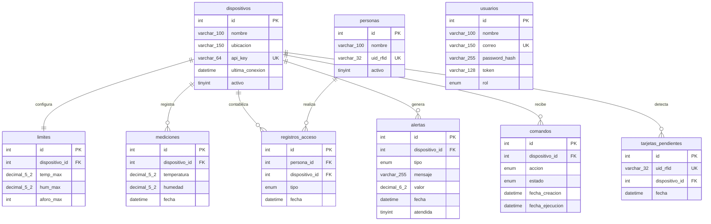

# 4. Modelo de datos

**Proyecto:** Aforo IoT — Sistema de control de acceso con RFID y monitoreo ambiental  
**Fecha:** Noviembre de 2026  
**Responsable:** OsvaldoVar  

---

## 4.1 Descripción del modelo

El modelo de datos del sistema **Aforo IoT** constituye la capa de persistencia centralizada implementada sobre el motor relacional MariaDB / MySQL (`aforo_iot`). Su arquitectura responde a los requerimientos de control de acceso físico automatizado, telemetría ambiental periódica, cálculo dinámico de aforo, gestión de umbrales operativos y administración de usuarios mediante una API REST en PHP 8.

El diseño desacopla las operaciones físicas del hardware embebido (nodos ESP32) de las interfaces de gestión móvil (aplicación Android), estructurando la información en nueve entidades tabulares y una vista relacional optimizada:

1. **`usuarios`:** almacena las credenciales de los operadores y administradores de la aplicación móvil. Implementa almacenamiento seguro de contraseñas mediante funciones de derivación criptográfica (`password_hash`) y autenticación basada en tokens opacos (`token`). Constituye una entidad aislada del hardware, garantizando que el acceso administrativo no dependa de identidades físicas de acceso.
2. **`personas`:** catálogo de individuos autorizados para acceder a los recintos vigilados. Asocia el nombre de la persona con el identificador único de su tarjeta RFID (`uid_rfid`) y un indicador de vigencia (`activo`).
3. **`dispositivos`:** inventario de los nodos de captura y actuación ESP32 desplegados en los puntos de control. Cada nodo se autentica ante la API mediante una clave unívoca (`api_key`), registrando su ubicación geográfica o física y su última marca de sincronización (`ultima_conexion`).
4. **`tarjetas_pendientes`:** tabla transitoria de captura en la que se registran las lecturas de tarjetas RFID no reconocidas en el catálogo de personas. Permite que un administrador asocie un identificador físico leído en sitio a un nuevo usuario desde la aplicación móvil sin captura manual de códigos hexadecimales.
5. **`registros_acceso`:** bitácora histórica transaccional e inmutable donde se asienta cada evento de acceso físico (`entrada` o `salida`), vinculando a la persona, el dispositivo donde se realizó la lectura y la marca temporal precisa del suceso.
6. **`mediciones`:** serie temporal de telemetría climatológica generada periódicamente (cada 15 segundos) por el sensor DHT22 conectado al ESP32, conteniendo valores de temperatura (°C) y humedad relativa (%).
7. **`limites`:** configuración de parámetros de control por dispositivo en relación uno a uno (1:1), estableciendo las cotas máximas admisibles de temperatura (`temp_max`), humedad (`hum_max`) y la capacidad de ocupación permitida (`aforo_max`).
8. **`alertas`:** registro de incidencias e infracciones a los umbrales configurados, generadas automáticamente ante mediciones climáticas fuera de rango o ante intentos de sobrecupo en el aforo, manteniendo su estado de resolución (`atendida`).
9. **`comandos`:** cola de instrucciones remotas generadas desde la aplicación móvil hacia el microcontrolador (`abrir_acceso`, `alarma`), permitiendo control bidireccional asíncrono con confirmación de ejecución.
10. **`personas_dentro` (Vista):** vista relacional calculada en tiempo real que determina la ocupación vigente en cada recinto evaluando el estado del último movimiento registrado por individuo y nodo.

---

## 4.2 Diagrama entidad-relación

A continuación se presenta el diagrama entidad-relación del sistema en notación Mermaid `erDiagram`. Los tipos de datos se representan sin paréntesis para garantizar el renderizado nativo en GitHub, incluyendo las restricciones de clave primaria (`PK`), clave foránea (`FK`) y clave única (`UK`), así como las cardinalidades exactas del esquema relacional:



---

## 4.3 Diccionario de datos

A continuación se detalla la especificación técnica de las nueve tablas físicas que componen el esquema relacional `aforo_iot`.

### 4.3.1 Tabla `usuarios`
Almacena las cuentas con privilegios de acceso a la aplicación móvil Android.

| Columna | Tipo de dato | Restricciones | Descripción |
| --- | --- | --- | --- |
| `id` | `INT UNSIGNED` | `PRIMARY KEY`, `AUTO_INCREMENT`, `NOT NULL` | Identificador secuencial único del usuario. |
| `nombre` | `VARCHAR(100)` | `NOT NULL` | Nombre completo del usuario o supervisor. |
| `correo` | `VARCHAR(150)` | `NOT NULL`, `UNIQUE (uq_usuarios_correo)` | Dirección de correo electrónico utilizada para inicio de sesión. |
| `password_hash` | `VARCHAR(255)` | `NOT NULL` | Hash de la contraseña generado mediante algoritmo bcrypt (`PASSWORD_BCRYPT`). |
| `token` | `VARCHAR(128)` | `NULL`, `DEFAULT NULL`, `INDEX (idx_usuarios_token)` | Token de autenticación de sesión activa enviado en encabezado `X-Token`. |
| `rol` | `ENUM('admin', 'usuario')` | `NOT NULL`, `DEFAULT 'usuario'` | Nivel de privilegios dentro del sistema móvil. |

### 4.3.2 Tabla `personas`
Catálogo de usuarios físicos autorizados para interactuar con los lectores RFID.

| Columna | Tipo de dato | Restricciones | Descripción |
| --- | --- | --- | --- |
| `id` | `INT UNSIGNED` | `PRIMARY KEY`, `AUTO_INCREMENT`, `NOT NULL` | Identificador secuencial único de la persona. |
| `nombre` | `VARCHAR(100)` | `NOT NULL` | Nombre completo de la persona titular de la tarjeta. |
| `uid_rfid` | `VARCHAR(32)` | `NOT NULL`, `UNIQUE (uq_personas_uid_rfid)` | Identificador de la tarjeta RFID en formato hexadecimal en mayúsculas. |
| `activo` | `TINYINT(1)` | `NOT NULL`, `DEFAULT 1` | Bandera de estado operativo (1 = activo/autorizado, 0 = baja lógica). |

### 4.3.3 Tabla `dispositivos`
Inventario de microcontroladores ESP32 registrados en el sistema.

| Columna | Tipo de dato | Restricciones | Descripción |
| --- | --- | --- | --- |
| `id` | `INT UNSIGNED` | `PRIMARY KEY`, `AUTO_INCREMENT`, `NOT NULL` | Identificador secuencial único del nodo IoT. |
| `nombre` | `VARCHAR(100)` | `NOT NULL` | Nombre identificador del dispositivo (ej. ESP32-Acceso-Lab1). |
| `ubicacion` | `VARCHAR(150)` | `NULL`, `DEFAULT NULL` | Descripción física de la sala, puerta o laboratorio donde opera el nodo. |
| `api_key` | `VARCHAR(64)` | `NOT NULL`, `UNIQUE (uq_dispositivos_api_key)` | Clave criptográfica única utilizada por el firmware para autenticarse ante la API. |
| `ultima_conexion` | `DATETIME` | `NULL`, `DEFAULT NULL` | Marca temporal del último contacto exitoso (latido) entre el ESP32 y el servidor. |
| `activo` | `TINYINT(1)` | `NOT NULL`, `DEFAULT 1` | Estado de habilitación del nodo (1 = operativo, 0 = inhabilitado). |

### 4.3.4 Tabla `tarjetas_pendientes`
Cola de captura para tarjetas leídas en campo cuyo UID no pertenece aún al catálogo `personas`.

| Columna | Tipo de dato | Restricciones | Descripción |
| --- | --- | --- | --- |
| `id` | `INT UNSIGNED` | `PRIMARY KEY`, `AUTO_INCREMENT`, `NOT NULL` | Identificador secuencial único del registro pendiente. |
| `uid_rfid` | `VARCHAR(32)` | `NOT NULL`, `UNIQUE (uq_tarjetas_pendientes_uid_rfid)` | UID hexadecimal en mayúsculas de la tarjeta detectada. |
| `dispositivo_id` | `INT UNSIGNED` | `NOT NULL`, `FK`, `INDEX (idx_tarjetas_pendientes_dispositivo)` | Clave foránea que referencia a `dispositivos(id)` (`ON DELETE CASCADE ON UPDATE CASCADE`). |
| `fecha` | `DATETIME` | `NOT NULL`, `DEFAULT CURRENT_TIMESTAMP`, `INDEX (idx_tarjetas_pendientes_fecha)` | Fecha y hora en que el sensor detectó la tarjeta no registrada. |

### 4.3.5 Tabla `registros_acceso`
Pista de auditoría histórica e inmutable de entradas y salidas físicas.

| Columna | Tipo de dato | Restricciones | Descripción |
| --- | --- | --- | --- |
| `id` | `INT UNSIGNED` | `PRIMARY KEY`, `AUTO_INCREMENT`, `NOT NULL` | Identificador secuencial del movimiento de acceso. |
| `persona_id` | `INT UNSIGNED` | `NOT NULL`, `FK`, `INDEX (idx_registros_acceso_persona)` | Clave foránea que referencia a `personas(id)` (`ON DELETE RESTRICT ON UPDATE CASCADE`). |
| `dispositivo_id` | `INT UNSIGNED` | `NOT NULL`, `FK`, `INDEX (idx_registros_acceso_dispositivo)` | Clave foránea que referencia a `dispositivos(id)` (`ON DELETE RESTRICT ON UPDATE CASCADE`). |
| `tipo` | `ENUM('entrada', 'salida')` | `NOT NULL` | Naturaleza del evento de acceso registrado. |
| `fecha` | `DATETIME` | `NOT NULL`, `DEFAULT CURRENT_TIMESTAMP`, `INDEX (idx_registros_acceso_fecha)` | Marca temporal precisa en la que se autorizó y completó el acceso. |

> **Nota de optimización:** Esta tabla incluye adicionalmente el índice compuesto cuádruple `idx_registros_acceso_persona_disp_fecha (persona_id, dispositivo_id, fecha, id)` para acelerar la vista de ocupación en tiempo real.

### 4.3.6 Tabla `mediciones`
Historial de lecturas ambientales de temperatura y humedad enviadas por los sensores DHT22.

| Columna | Tipo de dato | Restricciones | Descripción |
| --- | --- | --- | --- |
| `id` | `INT UNSIGNED` | `PRIMARY KEY`, `AUTO_INCREMENT`, `NOT NULL` | Identificador secuencial de la muestra telemétrica. |
| `dispositivo_id` | `INT UNSIGNED` | `NOT NULL`, `FK`, `INDEX (idx_mediciones_dispositivo)` | Clave foránea que referencia a `dispositivos(id)` (`ON DELETE CASCADE ON UPDATE CASCADE`). |
| `temperatura` | `DECIMAL(5,2)` | `NOT NULL` | Valor de temperatura en grados Celsius con dos decimales de precisión. |
| `humedad` | `DECIMAL(5,2)` | `NOT NULL` | Valor de humedad relativa ambiental en porcentaje (%) con dos decimales. |
| `fecha` | `DATETIME` | `NOT NULL`, `DEFAULT CURRENT_TIMESTAMP`, `INDEX (idx_mediciones_fecha)` | Marca temporal de la recepción y registro de la medición. |

> **Nota de optimización:** Incluye el índice compuesto `idx_mediciones_dispositivo_fecha (dispositivo_id, fecha)` para la consulta de gráficas históricas de 24 horas.

### 4.3.7 Tabla `limites`
Parámetros y umbrales operativos configurados por dispositivo (relación 1:1 estricta).

| Columna | Tipo de dato | Restricciones | Descripción |
| --- | --- | --- | --- |
| `id` | `INT UNSIGNED` | `PRIMARY KEY`, `AUTO_INCREMENT`, `NOT NULL` | Identificador secuencial único de la configuración. |
| `dispositivo_id` | `INT UNSIGNED` | `NOT NULL`, `FK`, `UNIQUE (uq_limites_dispositivo)` | Referencia foránea única a `dispositivos(id)` (`ON DELETE CASCADE ON UPDATE CASCADE`). |
| `temp_max` | `DECIMAL(5,2)` | `NOT NULL`, `DEFAULT 30.00` | Umbral máximo admisible de temperatura en °C antes de disparar alerta. |
| `hum_max` | `DECIMAL(5,2)` | `NOT NULL`, `DEFAULT 75.00` | Umbral máximo admisible de humedad relativa en % antes de disparar alerta. |
| `aforo_max` | `INT UNSIGNED` | `NOT NULL`, `DEFAULT 20` | Capacidad máxima de ocupantes permitidos simultáneamente en el recinto. |

### 4.3.8 Tabla `alertas`
Historial de advertencias disparadas automáticamente por superación de umbrales.

| Columna | Tipo de dato | Restricciones | Descripción |
| --- | --- | --- | --- |
| `id` | `INT UNSIGNED` | `PRIMARY KEY`, `AUTO_INCREMENT`, `NOT NULL` | Identificador secuencial de la alerta. |
| `dispositivo_id` | `INT UNSIGNED` | `NOT NULL`, `FK`, `INDEX (idx_alertas_dispositivo)` | Clave foránea que referencia a `dispositivos(id)` (`ON DELETE CASCADE ON UPDATE CASCADE`). |
| `tipo` | `ENUM('temperatura', 'humedad', 'aforo')` | `NOT NULL` | Criterio de origen de la condición de sobrepaso. |
| `mensaje` | `VARCHAR(255)` | `NOT NULL` | Detalle textual explicativo de la anomalía detectada. |
| `valor` | `DECIMAL(6,2)` | `NULL`, `DEFAULT NULL` | Magnitud numérica observada al momento de originarse la alerta. |
| `fecha` | `DATETIME` | `NOT NULL`, `DEFAULT CURRENT_TIMESTAMP`, `INDEX (idx_alertas_fecha)` | Marca temporal de disparo del incidente. |
| `atendida` | `TINYINT(1)` | `NOT NULL`, `DEFAULT 0`, `INDEX (idx_alertas_atendida)` | Estado de atención por parte del operador (0 = pendiente, 1 = revisada). |

### 4.3.9 Tabla `comandos`
Cola de instrucciones remotas dirigidas desde la aplicación móvil hacia el firmware ESP32.

| Columna | Tipo de dato | Restricciones | Descripción |
| --- | --- | --- | --- |
| `id` | `INT UNSIGNED` | `PRIMARY KEY`, `AUTO_INCREMENT`, `NOT NULL` | Identificador secuencial único del comando encolado. |
| `dispositivo_id` | `INT UNSIGNED` | `NOT NULL`, `FK`, `INDEX (idx_comandos_dispositivo)` | Clave foránea que referencia a `dispositivos(id)` (`ON DELETE CASCADE ON UPDATE CASCADE`). |
| `accion` | `ENUM('abrir_acceso', 'alarma')` | `NOT NULL` | Acción física a ejecutar por los actuadores locales del microcontrolador. |
| `estado` | `ENUM('pendiente', 'ejecutado')` | `NOT NULL`, `DEFAULT 'pendiente'`, `INDEX (idx_comandos_estado)` | Estado del ciclo de vida del comando en la cola de despacho. |
| `fecha_creacion` | `DATETIME` | `NOT NULL`, `DEFAULT CURRENT_TIMESTAMP`, `INDEX (idx_comandos_fecha_creacion)` | Marca temporal en la que el usuario generó la petición remota en la app. |
| `fecha_ejecucion` | `DATETIME` | `NULL`, `DEFAULT NULL` | Marca temporal en la que el ESP32 consumió y confirmó el comando. |

---

## 4.4 Vista de personas dentro (`personas_dentro`)

La vista `personas_dentro` resuelve de manera determinista y en tiempo real el conjunto de personas que se encuentran dentro de un recinto físico asociado a un dispositivo específico.

### 4.4.1 Definición SQL
De acuerdo con `database/schema.sql`, la vista se crea con la siguiente sentencia:

```sql
CREATE VIEW personas_dentro AS
SELECT
    p.id,
    p.nombre,
    r.dispositivo_id,
    r.fecha AS hora_entrada
FROM registros_acceso r
INNER JOIN personas p ON p.id = r.persona_id
WHERE r.tipo = 'entrada'
  AND NOT EXISTS (
      SELECT 1
      FROM registros_acceso r2
      WHERE r2.persona_id = r.persona_id
        AND r2.dispositivo_id = r.dispositivo_id
        AND (
            r2.fecha > r.fecha
            OR (r2.fecha = r.fecha AND r2.id > r.id)
        )
  );
```

### 4.4.2 Lógica relacional y resolución temporal
La regla operativa del sistema establece que una persona está dentro de un recinto si y solo si su último registro de acceso en el dispositivo correspondiente fue una `entrada`.

1. **Unión de entidades:** vincula cada registro de acceso `r` con la tabla `personas p` mediante `p.id = r.persona_id`, permitiendo proyectar el nombre del ocupante y la marca temporal de su acceso (`hora_entrada`).
2. **Filtro de evento actual:** restringe la selección principal a movimientos de tipo `entrada` (`r.tipo = 'entrada'`).
3. **Condición de última ocurrencia (`NOT EXISTS` correlacionado):**
   - La subconsulta inspecciona la tabla `registros_acceso` buscando una fila posterior `r2` para la misma persona y el mismo dispositivo.
   - **Criterio cronológico primario (`r2.fecha > r.fecha`):** si existe un registro más reciente en el tiempo, significa que el evento `r` ya no es el último movimiento del individuo en ese punto.
   - **Desempate determinista (`r2.fecha = r.fecha AND r2.id > r.id`):** en caso de que dos accesos consecutivos ocurran dentro del mismo segundo exacto (resolución `DATETIME`), el identificador autoincremental `r2.id > r.id` rompe la colisión garantizando un orden cronológico estricto sin ambigüedades.
4. **Comportamiento ante salidas:** si el último evento cronológico de una persona fue una `salida`, ese registro no cumple `r.tipo = 'entrada'` en la consulta externa; y para la `entrada` previa que sí cumplía el filtro, la subconsulta `NOT EXISTS` encuentra la `salida` posterior, descartando a la persona del resultado final.

### 4.4.3 Ventajas arquitectónicas
- **Integridad y consistencia:** no se requiere un campo mutable de estado (como `en_recinto TINYINT`) en la tabla `personas`, eliminando anomalías de sincronización ante fallos de concurrencia o errores en la red.
- **Inmutabilidad transaccional:** el historial de accesos se preserva como un diario puramente incremental (*append-only*).
- **Rendimiento mediante índice cubierto:** la evaluación de la correlación se ejecuta en memoria sobre el índice `idx_registros_acceso_persona_disp_fecha (persona_id, dispositivo_id, fecha, id)`, permitiendo al optimizador de MariaDB/MySQL resolver el predicado sin requerir accesos aleatorios a disco.

---

## 4.5 Decisiones de diseño y optimización

El esquema relacional adopta decisiones de ingeniería justificadas en la confiabilidad transaccional, el volumen de telemetría y la eficiencia de consulta requerida por los clientes IoT y Android:

### 4.5.1 Motor de almacenamiento InnoDB y codificación UTF-8 Multibyte
- **`ENGINE=InnoDB`:** seleccionado por su soporte nativo de transacciones ACID, bloqueo a nivel de fila (*row-level locking*) y aplicación rigurosa de restricciones de clave foránea. Esto previene condiciones de carrera cuando múltiples nodos ESP32 y peticiones concurrentes de la app acceden a la base de datos simultáneamente.
- **`DEFAULT CHARSET=utf8mb4 COLLATE=utf8mb4_unicode_ci`:** el conjunto `utf8mb4` permite almacenar caracteres Unicode completos de hasta 4 bytes (acentuaciones, caracteres especiales y símbolos internacionales en nombres y correos), eliminando vulnerabilidades de truncamiento presentes en implementaciones legadas de 3 bytes (`utf8mb3`). La colación `utf8mb4_unicode_ci` asegura ordenamientos y comparaciones lingüísticamente correctas.

### 4.5.2 Políticas de integridad referencial: `CASCADE` frente a `RESTRICT`
El esquema diferencia formalmente entre datos transitorios dependientes del ciclo de vida de un dispositivo y datos históricos sujetos a auditoría de seguridad:

1. **`ON DELETE CASCADE ON UPDATE CASCADE`:** aplicado en tablas dependientes de la infraestructura física:
   - `tarjetas_pendientes(dispositivo_id)`: si un dispositivo se desmantela, sus lecturas pendientes sin procesar se depuran en cascada.
   - `mediciones(dispositivo_id)`: las series de tiempo climáticas pertenecen al ciclo de vida del nodo que las capturó.
   - `limites(dispositivo_id)`: los umbrales de aforo y clima configuran al dispositivo físicamente; su eliminación arrastra su registro 1:1 de parámetros.
   - `alertas(dispositivo_id)` y `comandos(dispositivo_id)`: incidencias y comandos encolados se eliminan automáticamente si se da de baja el hardware asociado.
2. **`ON DELETE RESTRICT ON UPDATE CASCADE`:** aplicado estrictamente en `registros_acceso`:
   - `fk_registros_acceso_personas`: vincula a `personas(id)`.
   - `fk_registros_acceso_dispositivos`: vincula a `dispositivos(id)`.
   - **Justificación:** los registros de acceso físico representan una bitácora forense de seguridad. La base de datos prohíbe la eliminación física (`RESTRICT`) de cualquier persona o dispositivo que cuente con eventos de acceso asentados. Toda desincorporación de usuarios o puntos de acceso debe gestionarse mediante baja lógica (`activo = 0`), preservando la trazabilidad histórica para fines legales o de auditoría.

### 4.5.3 Estrategia de indexación para consultas y filtros temporales
La arquitectura implementa índices estratégicos para garantizar tiempos de respuesta inferiores a 1 segundo en consultas con volúmenes superiores a 1 000 registros:

- **Índices de filtrado temporal individual:** definidos en columnas `fecha` y `fecha_creacion` en `registros_acceso`, `mediciones`, `alertas`, `comandos` y `tarjetas_pendientes`. Permiten acelerar consultas con cláusulas de rango (`BETWEEN` o marcas de corte de 24 horas) empleadas en los reportes de la app Android y la exportación de archivos CSV.
- **Índice compuesto `idx_mediciones_dispositivo_fecha` (`dispositivo_id`, `fecha`):** optimiza la recuperación de la última medición telemétrica de un dispositivo en el tablero móvil (`ORDER BY fecha DESC LIMIT 1`) y la generación de series de tiempo para gráficas sin inducir ordenamientos en disco (*filesort*).
- **Índice compuesto cuádruple `idx_registros_acceso_persona_disp_fecha` (`persona_id`, `dispositivo_id`, `fecha`, `id`):** cubre todos los campos evaluados en la subconsulta correlacionada `NOT EXISTS` de la vista `personas_dentro`, permitiendo al motor de base de datos resolver la verificación de ocupación mediante un escaneo exclusivo de árbol B (*index-only scan*).
- **Índices secundarios operativos:** `idx_usuarios_token (token)` para validación de sesión de alta frecuencia en cada llamada con `X-Token`, `idx_alertas_atendida (atendida)` para el filtrado rápido de anomalías no resueltas, e `idx_comandos_estado (estado)` para la consulta periódica de comandos pendientes cada 3 segundos por parte del firmware.

### 4.5.4 Estandarización de identificadores RFID (`uid_rfid`) en mayúsculas
- **Formato hexadecimal canónico:** los identificadores leídos por el módulo RC522 se normalizan y almacenan en cadenas hexadecimales en mayúsculas (ejemplo: `A3B4C5D6`), sin separadores de dos puntos ni espacios. Esto evita discrepancias en búsquedas alfanuméricas directas.
- **Dimensión `VARCHAR(32)`:** provee compatibilidad nativa para tarjetas ISO/IEC 14443A estándar de 4 bytes (8 caracteres hexadecimales), tarjetas de 7 bytes (14 caracteres) como MIFARE Ultralight, y modelos de 10 bytes (20 caracteres), ofreciendo margen de escalabilidad para futuras tecnologías de credenciales sin requerir modificaciones estructurales en la base de datos.
- **Claves únicas:** las restricciones `uq_personas_uid_rfid` y `uq_tarjetas_pendientes_uid_rfid` generan índices B-tree que aseguran búsquedas en tiempo $O(1)$ en la validación crítica de acceso (`POST esp32/acceso.php`).
