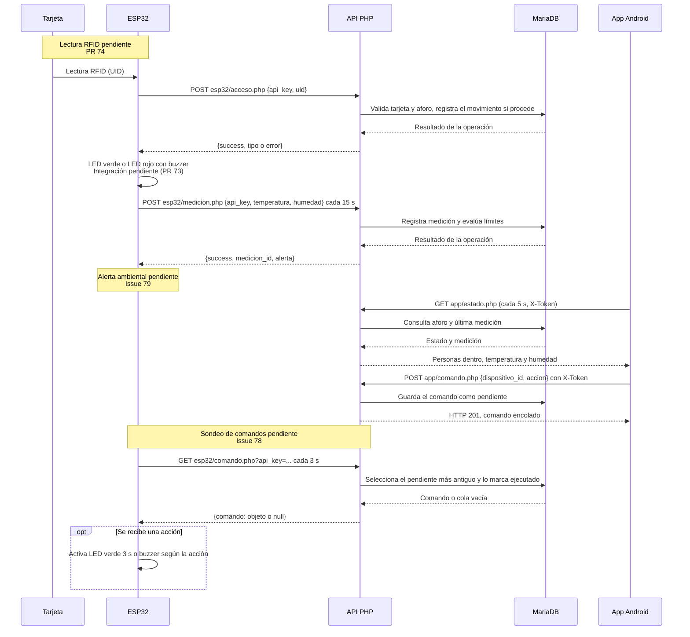

# 05 · Protocolo IoT

## Resumen

El ESP32 se comunica con la API PHP por HTTP sobre WiFi de 2.4 GHz. Las peticiones con cuerpo JSON usan `Content-Type: application/json` y los mensajes se codifican en UTF-8. El ESP32 se autentica con la `api_key` de un dispositivo activo y Android usa `X-Token` para consultar y operar la API. PHP es el único componente de este flujo que accede a MariaDB.

En la revisión de `develop` del commit `2fc08c9`, los tres endpoints del ESP32 están disponibles y el firmware principal ya envía mediciones. La lectura RFID y el POST de acceso están pendientes en el PR #74. El PR #75 separa el sondeo RFID de la lectura del sensor y de HTTP mediante FreeRTOS. El PR #73 prepara la señalización local de acceso y aún requiere conectarla a ese flujo. La consulta de comandos y su actuación local corresponden al Issue #78. La señalización ante aforo lleno o alerta ambiental corresponde al Issue #79, aunque la API ya devuelve ambos resultados.

## Endpoints del ESP32

Las rutas son relativas a `/api_aforo/`. Las respuestas JSON incluyen `success` y `mensaje`, junto con los campos específicos en el nivel raíz.

| Endpoint | Método | Cuándo se llama | Cuerpo enviado | Respuesta | Códigos HTTP |
| --- | --- | --- | --- | --- | --- |
| `esp32/acceso.php` | POST | Al aceptar una lectura RFID (PR #74). | JSON con `api_key` y `uid` hexadecimal. El servidor recorta el UID y lo convierte a mayúsculas. | Con `success: true`, devuelve `tipo` (`entrada` o `salida`), `nombre` y `dentro`. Con `success: false`, el campo `error` distingue `tarjeta_no_registrada` de `aforo_lleno`. | `200` para registro o rechazo de negocio, `400` por JSON inválido o UID vacío, `401` por autenticación, `405` por método y `500` por fallo interno. |
| `esp32/medicion.php` | POST | Cada 15 s en condiciones normales. | JSON con `api_key`, `temperatura` en °C y `humedad` en % HR. Ambos valores deben ser numéricos y finitos. | `medicion_id`, `dispositivo_id`, temperatura, humedad y `alerta` booleano, que indica si se superó algún límite. | `200` para registro, `400` por JSON o datos inválidos, `401` por autenticación, `405` por método y `500` por fallo interno. |
| `esp32/comando.php` | GET | Cada 3 s en el flujo previsto del Issue #78. | Sin cuerpo en el flujo previsto. Envía `api_key` en la URL. | `comando: null` si la cola está vacía. Si hay un comando pendiente, devuelve `id`, `dispositivo_id`, `accion`, `estado`, `fecha_creacion` y `fecha_ejecucion` dentro de `comando`. | `200` con comando o cola vacía, `401` por autenticación, `405` por método y `500` por fallo interno. |

Los POST también admiten `X-Api-Key` si el campo del cuerpo está vacío. El GET de comandos busca la clave, en orden, en la URL, en `X-Api-Key` y en un eventual cuerpo JSON.

## Ejemplos JSON

Las respuestas se capturaron en la etapa 1 contra PHP y MariaDB aislados, con peticiones de la colección Postman y datos de prueba. La clave de los ejemplos pertenece al dispositivo de demostración del proyecto.

### Acceso

Petición de prueba

```http
POST /api_aforo/esp32/acceso.php
Content-Type: application/json

{"api_key":"demo-esp32-key-0001","uid":"A1B2C3D4"}
```

Respuesta observada, HTTP 200

```json
{"success":true,"mensaje":"Entrada registrada","tipo":"entrada","nombre":"Ana Martinez","dentro":2}
```

### Medición

Petición de prueba

```http
POST /api_aforo/esp32/medicion.php
Content-Type: application/json

{"api_key":"demo-esp32-key-0001","temperatura":24.5,"humedad":55.2}
```

Respuesta observada, HTTP 200

```json
{"success":true,"mensaje":"Medición registrada","medicion_id":7,"dispositivo_id":1,"temperatura":24.5,"humedad":55.2,"alerta":false}
```

### Comando

Petición de prueba

```http
GET /api_aforo/esp32/comando.php?api_key=demo-esp32-key-0001
```

Respuesta observada, HTTP 200

```json
{"success":true,"mensaje":"No hay comandos pendientes","comando":null}
```

Esta ejecución observó la cola vacía. La entrega de un comando y la consulta siguiente sin pendientes están registradas en los casos API-76 y API-77 del [informe de pruebas de la API](../pruebas/informe-pruebas-api.md).

## Tiempos

| Operación | Intervalo o espera | Precisión |
| --- | --- | --- |
| Medición ambiental | 15 s | Se programa con `millis()` en condiciones normales. El kit usa DHT11 por defecto. El DHT22 es configurable mediante `DHT_TIPO`. |
| Consulta de comandos | 3 s | Intervalo previsto en el Issue #78. La actuación física en menos de 4 s sigue pendiente de validación. |
| Antirrebote RFID | 3 s por UID | Previsto en el PR #74. Dejar una tarjeta en el campo no equivale a presentarla de nuevo. |
| HTTP | 3 s para conexión y 3 s para lectura | Son tiempos de espera configurados por separado. HTTP es síncrono en el firmware de referencia. El PR #75 traslada ese trabajo fuera de `loop()`. |
| Reconexión WiFi | 10 s entre intentos | Se programa con `millis()` mientras la conexión está caída. |
| Recuperación del envío de mediciones | Al menos 30 s tras un fallo temporal | Al llegar un intervalo disponible, se intenta enviar una muestra nueva. |
| Refresco del Dashboard | Aproximadamente 5 s | Android consulta la API con `X-Token`. |

## Manejo de errores

- **HTTP 400 y 401.** El firmware de mediciones registra en el monitor serie que los datos fueron rechazados o que debe revisarse la clave. Estos códigos no activan la pausa de los fallos temporales.
- **HTTP 5xx, 408 y 429, errores de red o JSON inválido en HTTP 200.** El envío de mediciones entra en pausa y luego toma una muestra nueva. El POST anterior pudo haber quedado registrado.
- **Sin WiFi o con una lectura no finita.** Se omite la medición. El firmware mantiene los intentos de reconexión aunque el envío esté en pausa.
- **Acceso, pendiente en el PR #74.** Solo se confirma una entrada o salida si la respuesta HTTP 200 contiene `success: true` como booleano y un `tipo` válido. Los rechazos de negocio, los errores y las respuestas inválidas se registran por separado. Un POST de acceso con resultado incierto no se reenvía automáticamente.

## Diagrama de secuencia

El diagrama combina la comunicación ya disponible con los pasos de firmware señalados como pendientes.



En el flujo de comandos, el estado `ejecutado` confirma que la API entregó el comando. La actuación física carece de un acuse separado del ESP32.
