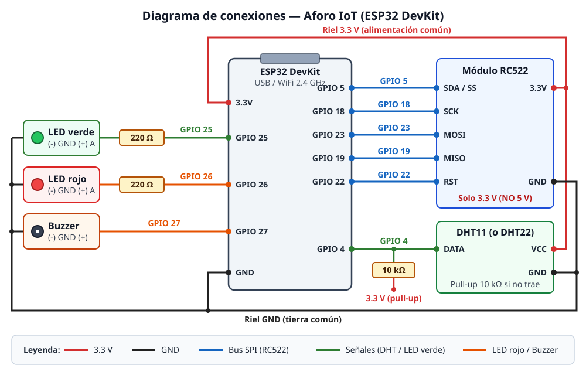
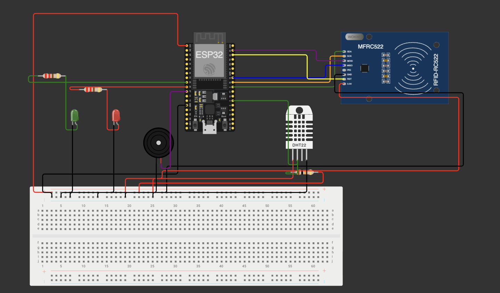

# Conexiones de hardware — Aforo IoT

Este documento describe el cableado físico entre la placa **ESP32 DevKit** y los periféricos del nodo IoT (lector RFID RC522, sensor de temperatura y humedad DHT11, LED verde, LED rojo y buzzer). La asignación de pines coincide con los `#define` de [`firmware/esp32_aforo/esp32_aforo.ino`](../../firmware/esp32_aforo/esp32_aforo.ino).

## Circuito simulado en Wokwi

## Tabla de pines

| Componente | Pin del componente | GPIO del ESP32 | Notas |
| --- | --- | --- | --- |
| **Protoboard** | Riel positivo (`+`) | `3.3V` | Alimentación común de 3.3 V para todos los módulos. |
| **Protoboard** | Riel negativo (`-`) | `GND` | Tierra común del circuito. |
| **Lector RC522** | `SDA` / `SS` | `GPIO 5` | Selección de esclavo SPI (`SS_PIN`). |
| **Lector RC522** | `SCK` | `GPIO 18` | Reloj SPI (`SCK_PIN`). |
| **Lector RC522** | `MISO` | `GPIO 19` | Datos maestro entrada / esclavo salida (`MISO_PIN`). |
| **Lector RC522** | `RST` | `GPIO 22` | Reinicio del lector (`RST_PIN`). |
| **Lector RC522** | `MOSI` | `GPIO 23` | Datos maestro salida / esclavo entrada (`MOSI_PIN`). |
| **Lector RC522** | `3.3V` | `3.3V` | **No conectar a 5 V.** |
| **Lector RC522** | `GND` | `GND` | Tierra común. |
| **Sensor DHT11** | `DATA` | `GPIO 4` | Señal digital (`DHT_PIN`). Usar resistencia pull-up de 10 kΩ entre `DATA` y `3.3V` si el módulo no la incluye integrada. |
| **Sensor DHT11** | `VCC` | `3.3V` | Alimentación a 3.3 V. |
| **Sensor DHT11** | `GND` | `GND` | Tierra común. |
| **LED verde** | Ánodo (`+`) | `GPIO 25` | Conectar en serie con resistencia limitadora de 220 Ω (`LED_VERDE`). |
| **LED verde** | Cátodo (`-`) | `GND` | Tierra común. |
| **LED rojo** | Ánodo (`+`) | `GPIO 26` | Conectar en serie con resistencia limitadora de 220 Ω (`LED_ROJO`). |
| **LED rojo** | Cátodo (`-`) | `GND` | Tierra común. |
| **Buzzer** | Positivo (`+`) | `GPIO 27` | Señal de tono a 2000 Hz (`BUZZER`). |
| **Buzzer** | Negativo (`-`) | `GND` | Tierra común. |

## Notas de alimentación y montaje

- **Voltaje de operación:** Todo el circuito opera a **3.3 V** con **GND común** en la protoboard. Desconecta el cable USB del ESP32 antes de mover o agregar cables.
- **Protección del RC522:** El módulo RFID RC522 trabaja exclusivamente a **3.3 V**. Conectarlo a 5 V puede dañarlo de forma permanente.
- **Resistencias en los LEDs:** Tanto el LED verde (`GPIO 25`) como el LED rojo (`GPIO 26`) deben llevar una resistencia de **220 Ω** en serie para limitar la corriente del pin.
- **Sensor DHT11 y opción DHT22:** El kit de hardware incluye un **DHT11**, que es el tipo configurado por defecto en el firmware (`#define DHT_TIPO DHT11`). Si se sustituye por un **DHT22**, basta con definir `#define DHT_TIPO DHT22` en `firmware/esp32_aforo/config.h` sin cambiar el pin `GPIO 4`.
- **Resistencia pull-up del DHT:** Si se usa el encapsulado suelto (sin placa de módulo con pull-up integrada), coloca una resistencia de **10 kΩ** entre `DATA` y `3.3V`.

## Simulación y evidencias del montaje real

- Guía de simulación en Wokwi: [wokwi.md](wokwi.md) (basada en [diagram.json](diagram.json)).
- Fotografía del montaje terminado en protoboard: [fotos/montaje.jpg](fotos/montaje.jpg).
- Fotografía del montaje durante las pruebas de hardware: [../capturas/hw_montaje.png](../capturas/hw_montaje.png).
