# Manual de usuario - Aforo IoT

Guía de uso de la aplicación Android **Aforo IoT** para el control de acceso RFID y el monitoreo de temperatura y humedad del espacio.

## Contenido

1. [Requisitos](#requisitos)
2. [Iniciar sesión](#iniciar-sesión)
3. [Dashboard](#dashboard)
4. [Historial y exportación CSV](#historial-y-exportación-csv)
5. [Personas](#personas)
6. [Dispositivos](#dispositivos)
7. [Alertas](#alertas)
8. [Límites](#límites)
9. [Gráficas](#gráficas)
10. [Notificaciones](#notificaciones)
11. [Cerrar sesión](#cerrar-sesión)

## Requisitos

- Teléfono Android 8.0 o superior conectado a la misma red que el servidor.
- Servidor PHP con la base de datos `aforo_iot` en ejecución.
- URL del servidor configurada en el proyecto al compilar (`aforo.baseUrl` en `android/local.properties`).

Si el servidor no responde, la app mantiene la pantalla abierta y muestra un aviso con la opción de reintentar. La operación se puede repetir cuando vuelva la conexión.

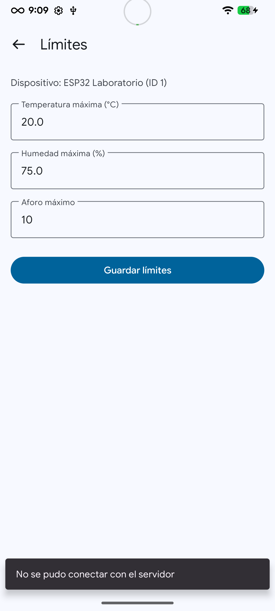

## Iniciar sesión

Al abrir la app se muestra el formulario de acceso. Escribe el correo y la contraseña del usuario y pulsa **Entrar**. Si aún no tienes cuenta, usa el enlace de registro.

Si las credenciales son incorrectas, la app muestra el mensaje de error del servidor sin cerrar el formulario.

Si cambió la IP de la computadora, pulsa **Configurar servidor** antes de entrar y escribe la URL base, por ejemplo `http://192.168.0.102:8080/api_aforo/`. La app agrega `http://`, la barra final y `/api_aforo/` si faltan. También se puede cambiar después en **Más → Servidor**; la URL queda guardada en el teléfono.

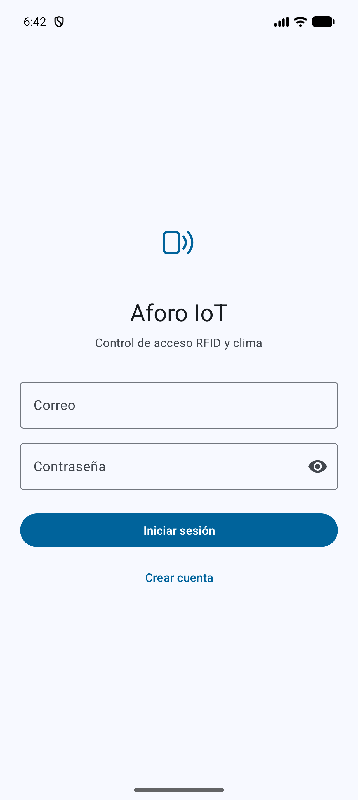

La sesión se conserva al cerrar la app: al volver a abrirla se entra directo al Dashboard.

## Dashboard

El Dashboard resume el estado del espacio: personas dentro, aforo máximo, temperatura y humedad actuales, y las últimas mediciones. Se actualiza automáticamente cada pocos segundos.

Dos botones permiten actuar sobre el hardware:

- **Abrir acceso**: pide confirmación y envía el comando para abrir la puerta.
- **Activar alarma**: pide confirmación y envía el comando para encender la alarma.

El resultado de cada comando se muestra en un aviso inferior (Snackbar).

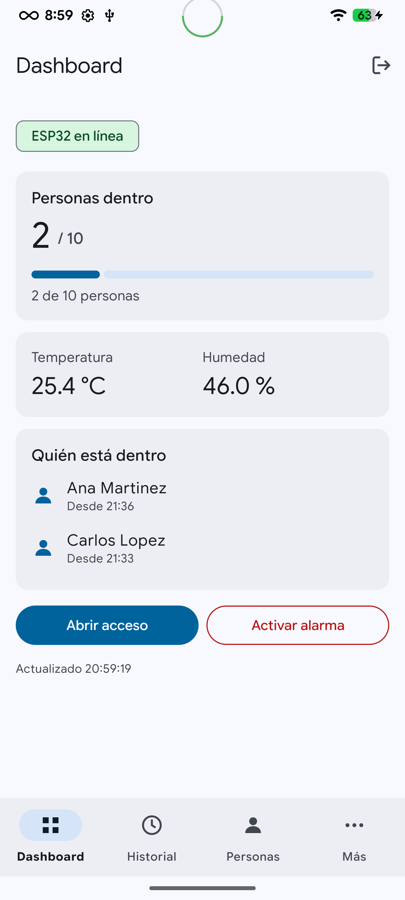

## Historial y exportación CSV

La pestaña **Historial** tiene dos vistas:

- **Accesos**: entradas y salidas registradas, con nombre, tipo y fecha.
- **Mediciones**: lecturas de temperatura y humedad.

El botón **Todo el historial** abre un selector para limitar el rango de fechas. El botón **Exportar CSV** genera un archivo `historial.csv` con los datos de la pestaña activa y abre la hoja de compartir del teléfono para enviarlo por correo, mensajería o guardarlo en el almacenamiento.

La exportación incluye los registros visibles en pantalla (máximo 100). Para rangos más grandes, acota las fechas.

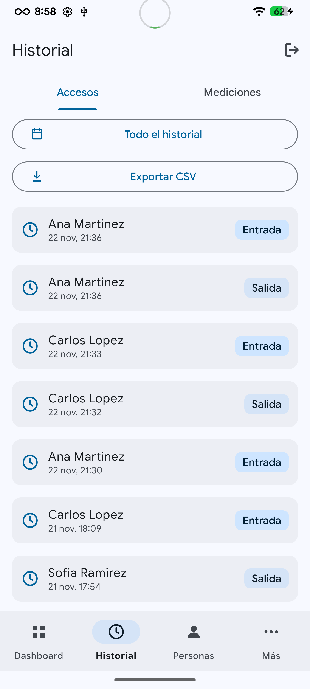

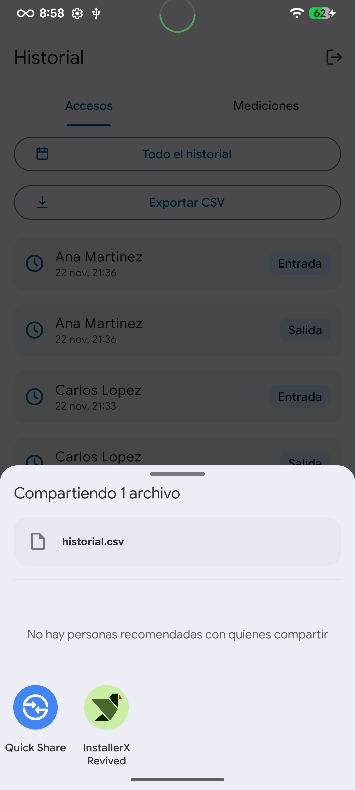

Si la pestaña no tiene registros, la app avisa que no hay datos para exportar.

## Personas

Lista las personas registradas con su estado y UID de la tarjeta RFID. El botón flotante permite dar de alta una nueva persona y capturar su tarjeta. Las tarjetas pendientes de asignar aparecen en la sección inferior.

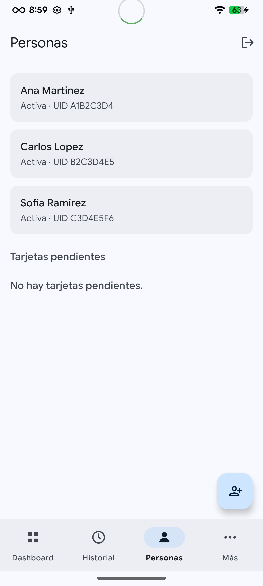

## Dispositivos

Desde **Más → Dispositivos** se administran los ESP32: alta, edición, activación y copia de la API key que usa el firmware para autenticarse.

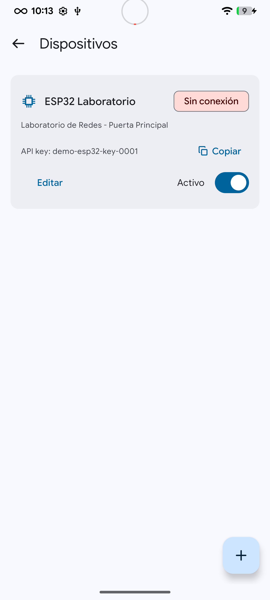

## Alertas

**Más → Alertas** muestra las alertas generadas por el sistema (temperatura, humedad o aforo excedido). Cada alerta indica su tipo, fecha y estado; se puede marcar como atendida.

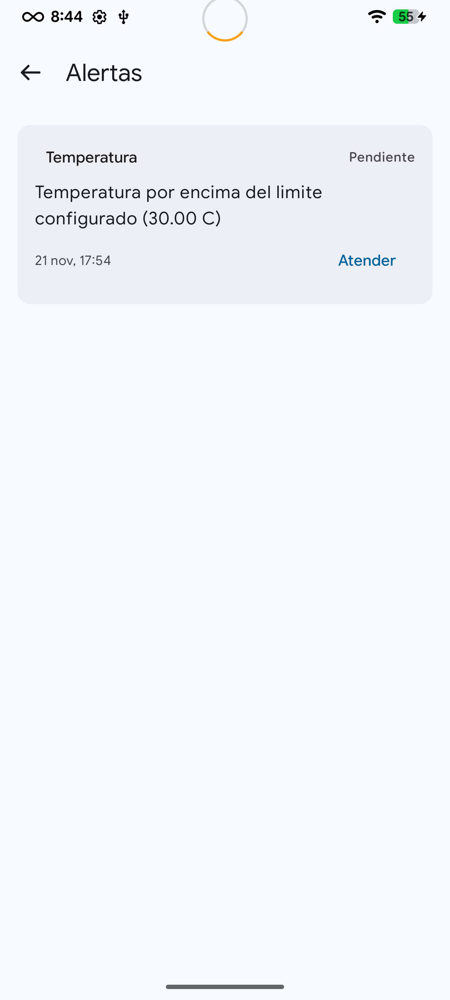

## Límites

**Más → Límites** permite configurar los umbrales que disparan las alertas: temperatura máxima, humedad máxima y aforo máximo. Al guardar, los valores se envían al servidor y se aplican a las siguientes mediciones.

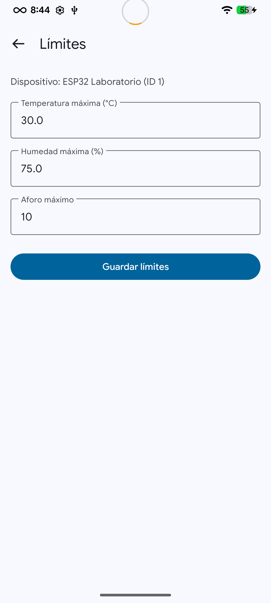

## Gráficas

**Más → Gráficas** muestra dos gráficas de las últimas 24 horas:

- Línea de temperatura y humedad.
- Barras con las entradas por hora.

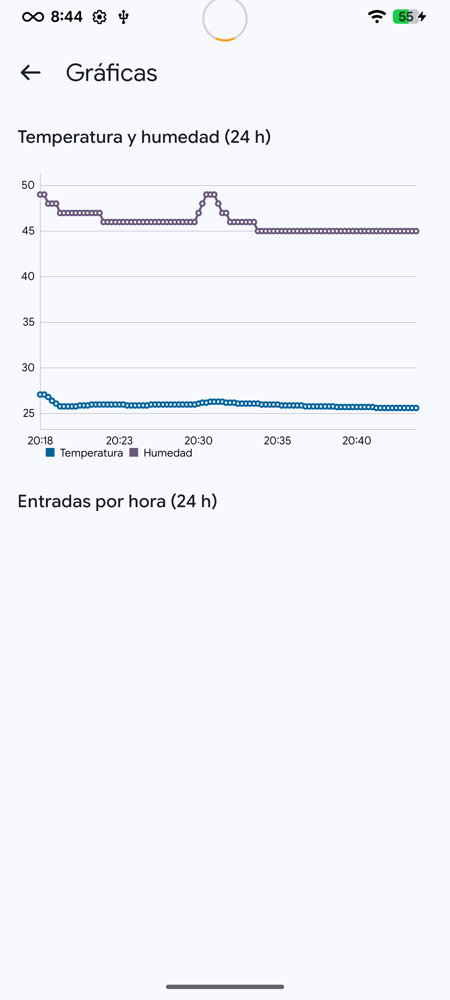

## Servidor

En **Más → Servidor** se puede cambiar la URL de la API sin recompilar la app, por ejemplo cuando la laptop recibe otra IP por DHCP. Acepta una IP o una URL completa; si falta `http://`, la barra final o `/api_aforo/`, la app los agrega. El cambio se guarda en el teléfono y se aplica a las peticiones siguientes.

## Notificaciones

Mientras la sesión está activa, la app mantiene un servicio en primer plano que consulta las alertas pendientes. Cuando aparece una alerta nueva se muestra una notificación **Nueva alerta** con el mensaje del servidor; al tocarla se abre la app.

En Android 13 o superior hay que aceptar el permiso de notificaciones la primera vez. El servicio se detiene al cerrar sesión.

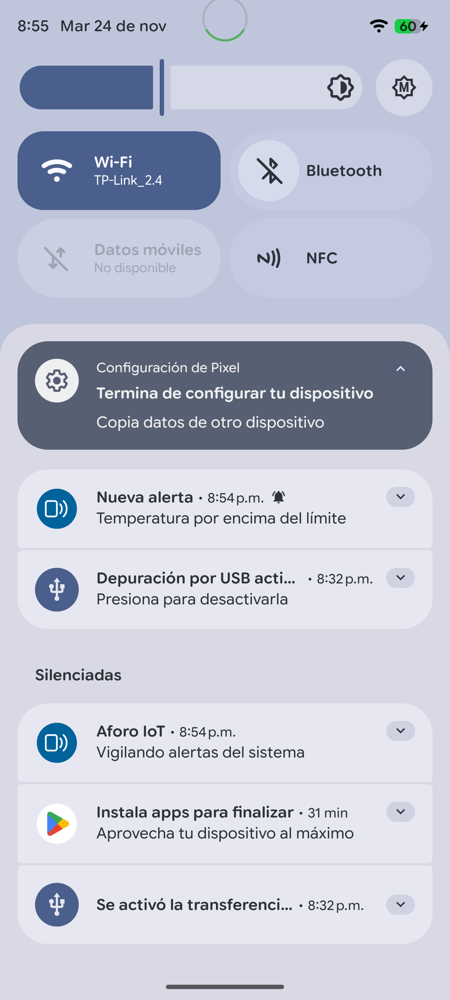

## Cerrar sesión

El icono de salida de la barra superior cierra la sesión y detiene el monitoreo de alertas. Antes de salir, la app pide confirmación.

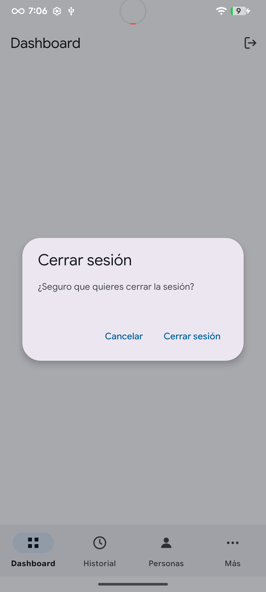
